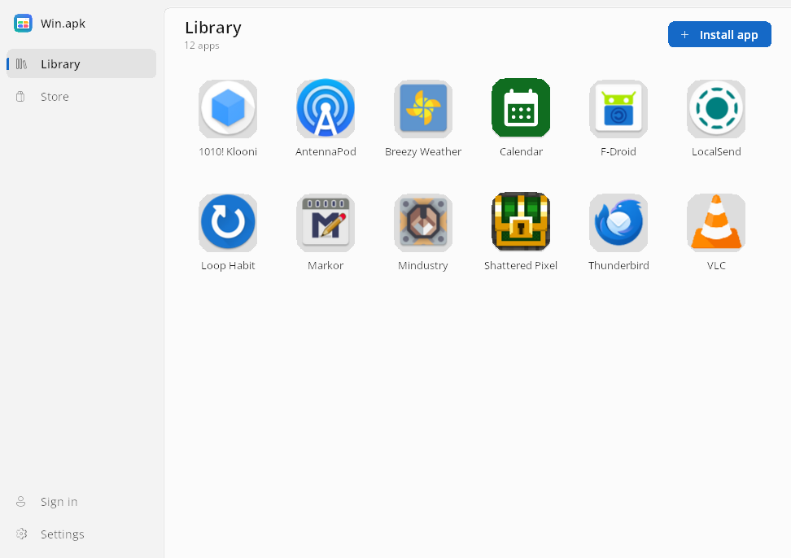
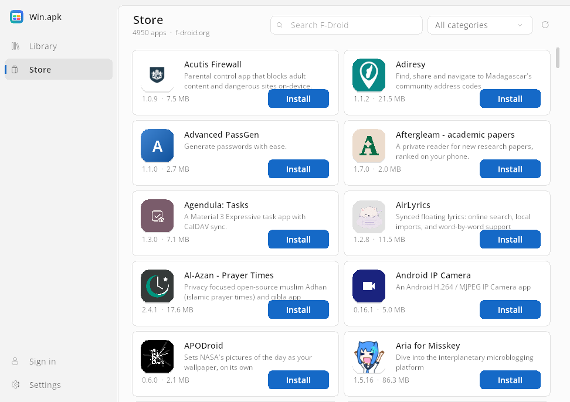
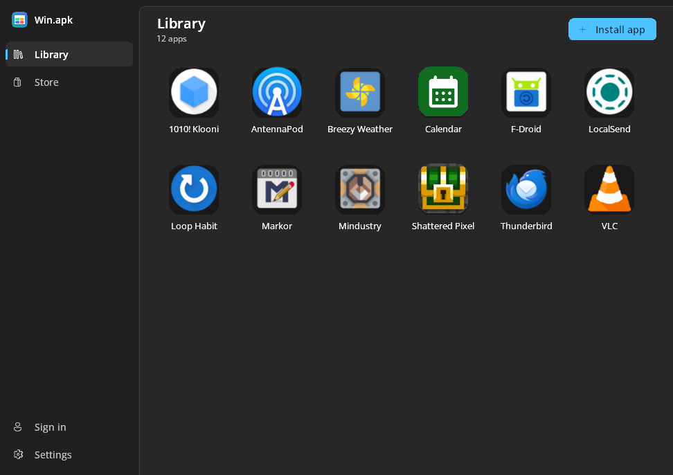
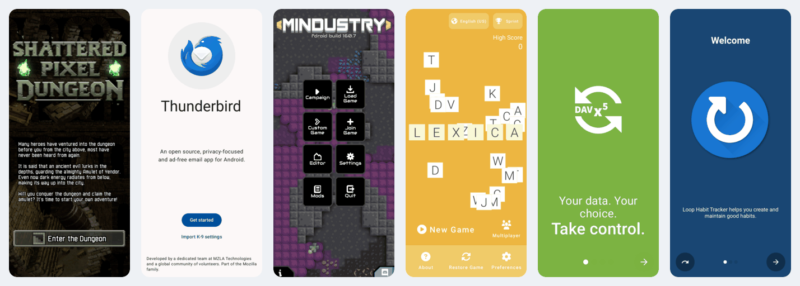

# ‏Win.apk

**אפליקציות אנדרואיד ב-Windows, כתוכנות Windows רגילות. בלי אמולטור ובלי מכונה וירטואלית.**

‏[English](README.md) · **עברית**

‏Win.apk מתקין אפליקציות אנדרואיד (`.apk`, `.apkm`, `.xapk`, `.apks`) ומריץ כל
אחת בחלון משלה, עם קיצור דרך בתפריט התחל, אייקון בשורת המשימות והתראות של
Windows. זו הסבה לא רשמית של [Mac.apk](https://github.com/kksimp/Mac.apk)
ל-Windows.

> **גרסת תצוגה ציבורית (v0.8).** הרבה אפליקציות עובדות טוב, אחרות עובדות
> חלקית או עדיין לא. לפני שסומכים על אפליקציה כדאי להציץ ב[טבלת התאימות](docs/APPS.md),
> ונשמח ש[תדווחו](docs/he/troubleshooting.md#דיווח-על-בעיה) מה מצאתם.

## מה יש בו

- **כל אפליקציה היא תוכנת Windows.** חלון משלה שאפשר לשנות את גודלו, קיצור
  דרך בתפריט התחל ואייקון בשורת המשימות. ההתראות שלה מגיעות כהתראות של
  Windows.
- **התקנה כמו שמצפים.** לחיצה כפולה או גרירה של קובץ `.apk` או חבילה מפוצלת
  (`.apkm`, `.xapk`, `.apks`), או התקנה מהחנות המובנית של
  [F-Droid](https://f-droid.org).
- **החומרה של המחשב.** מצלמת רשת, מיקרופון, המיקום של Windows, התקני Bluetooth
  שצימדתם, מידע על ה-Wi-Fi, בקרי Xbox, תיקיות ההורדות והתמונות שלכם, והלוח
  (העתק-הדבק).
- **גם אפליקציות ARM.** אפליקציות שנבנו רק למעבדי ARM של 64 ביט מתורגמות
  למעבד שלכם ברקע, בעדיפות הנמוכה ביותר.
- **כניסה עם חשבון Google מובנית,** ובאופן ניסיוני גם שירותי Google Play
  וחנות Play המקוריים של Google.
- **עברית ואנגלית,** מצב בהיר וכהה. בעברית הכול מימין לשמאל, כולל ההתקנה.

| החנות (F-Droid) | ערכת נושא כהה | אפליקציות מההרצה האוטומטית |
|---|---|---|
|  |  |  |

## במה זה שונה מאמולטור

אמולטורים ומכונות וירטואליות (BlueStacks, האמולטור של Android Studio,
Windows Subsystem for Android) מפעילים מערכת אנדרואיד שלמה ומריצים את
האפליקציות בתוכה. Win.apk בונה מחדש רק את מה שאפליקציה צריכה, על גבי Windows:

- **אין מה לאתחל ואין שום דבר ברקע.** לא רצה מערכת אנדרואיד, והזיכרון הולך
  רק לאפליקציות שפתחתם.
- **בלי Hyper-V ובלי וירטואליזציה,** אין מה להפעיל ב-BIOS.
- **שילוב אמיתי ב-Windows:** חלון לכל אפליקציה, Alt+Tab, הצמדת חלונות
  (Snap), התראות של Windows, והתיקיות שלכם כאחסון המשותף של "הטלפון".
- **חומרה אמיתית דרך ממשקי Windows עצמם,** לא התקנים מדומים.

ובכנות: אמולטור מריץ היום יותר אפליקציות.
[איך Win.apk עובד](docs/how-it-works.md) (באנגלית) מסביר את זה בפשטות.

## מה עובד

הטבלה המלאה, שנבדקה מול הקוד, נמצאת ב[טבלת התאימות](docs/APPS.md#what-works)
(באנגלית). בקצרה:

| ✅ עובד | ⚠️ חלקי | ❌ עדיין לא |
|---|---|---|
| אפליקציות Java ו-Kotlin | אפליקציות עם קוד arm64 בלבד: איטיות עד שהתרגום מוכן | אפליקציות עם קוד ARM של 32 ביט בלבד (`armeabi-v7a`) |
| קוד מקורי x86_64 | ‏`MediaCodec`: וידאו H.264 עם שמע AAC/MP3 | ‏Vulkan |
| ‏OpenGL ES 1.1 עד 3.2 על Direct3D 11, משחקי `NativeActivity` | ‏Bluetooth: התקנים מצומדים, RFCOMM, סריקת LE ולקוח GATT | ‏OpenSL ES (חלק מהמשחקים שקטים) |
| שמע (AudioTrack, SoundPool, פלט AAudio), מיקרופון | ‏Wi-Fi: מידע בלבד, בלי התחברות לרשת | ממשק המדיה של ה-NDK (`AMediaCodec`) |
| וידאו (`MediaPlayer`, `VideoView`) על Media Foundation | התראות: בלי כפתורי פעולה | חיישנים אמיתיים (הם מדווחים על טלפון מונח ללא תנועה) |
| ‏WebView ו-Custom Tabs על WebView2 | שירותי Google Play וחנות Play המקוריים (ניסיוני) | רכישות מתוך אפליקציה, Play Integrity, המפה של Maps SDK |
| מצלמה, מיקום, לוח, בחירת קבצים, בקרי Xbox | קלט: אצבע אחת, בלי מגע מרובה | |
| הרשאות, כניסה עם Google, הודעות Push ‏(FCM) | | |

**נמדד, לא הובטח:**

- בהרצה האוטומטית האחרונה, **90 מתוך 92** אפליקציות קוד פתוח מ-F-Droid,
  מכל הסוגים, עלו וציירו את המסך הראשון שלהן ב-Windows
  ([פרטים](docs/APPS.md#the-automated-sweep)). לעלות זה לא אותו דבר כמו שכל
  המסכים יעבדו.
- אפליקציות ARM צורכות פחות זיכרון אחרי התרגום: בשיא, Jitsi Meet צרכה
  516MB לעומת 742MB ב-JIT, ו-Telegram X ‏412MB לעומת 521MB.

## התקנה

**דרישות:** Windows 10 (גרסה 1903 ומעלה) או Windows 11, ‏64 ביט, על מעבד Intel
או AMD; כ-500MB פנויים בדיסק; כרטיס גרפי עם Direct3D 11 (בלעדיו יש רינדור
בתוכנה, איטי יותר); ‏Microsoft Edge WebView2 Runtime לדפי אינטרנט בתוך
אפליקציות ולכניסה עם Google (קיים כבר ב-Windows 11 וברוב מחשבי Windows 10).
לא צריך הרשאות מנהל.

1. מורידים את **`Win.apk-Setup.exe`** מה[גרסה האחרונה](https://github.com/israel2176/win.apk/releases/latest)
   (או את `Win.apk-windows-x64.zip` לגרסה ניידת, בלי התקנה).
2. מריצים. **SmartScreen יזהיר**, כי גרסת התצוגה עדיין לא חתומה דיגיטלית:
   לוחצים **מידע נוסף** (More info) ואז **הפעל בכל זאת** (Run anyway).
3. פותחים את Win.apk ומתקינים אפליקציה מה**חנות**, או לוחצים לחיצה כפולה על
   קובץ APK.

[צעדים ראשונים](docs/he/getting-started.md) מסביר את כל זה, עם צילומי מסך.

### איזו גרסה של אפליקציה להוריד

אפליקציות אנדרואיד עשויות להכיל קוד לסוג מסוים של מעבד. כשמורידים אפליקציה
לבד:

1. ‏**x86_64**, או גרסה בלי קוד מקורי (`noarch`), היא הטובה ביותר: רצה ישירות.
2. **חבילה שכוללת פיצול x86_64** טובה באותה מידה: Win.apk בוחר בו לבד.
3. ‏**arm64-v8a** עובדת, דרך תרגום, ואיטית בהפעלות הראשונות.
4. ‏**armeabi-v7a בלבד** (ARM של 32 ביט) לא תעבוד.

החנות המובנית בוחרת בשבילכם. [למה?](docs/he/getting-started.md#איזו-גרסה-להוריד)

## תיעוד

| | |
|---|---|
| [צעדים ראשונים](docs/he/getting-started.md) | דרישות, התקנת Win.apk, האפליקציה הראשונה |
| [שירותי Google](docs/he/google-services.md) | כניסה לחשבון, והתקנת שירותי Google Play וחנות Play |
| [פתרון בעיות ודיווח](docs/he/troubleshooting.md) | בעיות נפוצות, קריאת יומן, דיווח על בעיה |
| [שאלות נפוצות](docs/he/faq.md) | תשובות קצרות |
| ‏[Compatibility](docs/APPS.md) (אנגלית) | מה עובד, מה חלקי ומה חסר; אפליקציות שנבדקו |
| ‏[User guide](docs/USER_GUIDE.md) (אנגלית) | כל מסך וכל הגדרה |
| ‏[ARM apps](docs/arm-apps.md) (אנגלית) | התרגום של קוד ARM, לעומק |
| ‏[How it works](docs/how-it-works.md) (אנגלית) | איך זה עובד, והשוואה לאמולטור |

## מצב נוכחי ומגבלות

‏Win.apk היא גרסת תצוגה. צפו לאפליקציות שלא עולות, ליכולות חסרות
([הרשימה, לפי חשיבות](docs/APPS.md#needs-improvement-by-importance)) ולשינויים
בין גרסאות. שני דברים חשוב לדעת לפני שמתקינים אפליקציות:

- **אין הפרדה (Sandbox) בין אפליקציות.** כל אפליקציה רצה עם ההרשאות של
  משתמש ה-Windows שלכם, כמו כל תוכנה. התקינו רק אפליקציות שאתם סומכים עליהן
  ([SECURITY.md](SECURITY.md)).
- **בדיקות השלמות (Integrity) והתשלומים של Google לא זמינים,** ולא יזויפו.
  אפליקציות שדורשות אותם (הרבה אפליקציות בנקאות ותשלומים, רכישות מתוך
  אפליקציה) לא יעבדו במלואן.

## איך אפשר לעזור

הכי מועיל עכשיו: לנסות אפליקציות. מה שלא עובד מדווחים דרך **דיווח על בעיה**
ב-Win.apk, ומה שנבדק מוסיפים כשורה ב[רשימת התאימות](docs/APPS.md#adding-a-row).
גם קוד יתקבל בברכה: הכללים ב-[CONTRIBUTING.md](CONTRIBUTING.md) (להתנהג כמו
אנדרואיד, בלי קוד ייעודי לאפליקציה מסוימת). אפשר לכתוב בעברית.

## קרדיטים

- ‏**[Mac.apk](https://github.com/kksimp/Mac.apk)** של קיילב סימפסון
  ([@kksimp](https://github.com/kksimp), ‏Voltare) והתורמים לו: Win.apk התחיל
  כהסבה שלו, וסביבת האנדרואיד (`runtime/`: המימוש מחדש של ה-Framework, ממיר
  ה-DEX, תחליפי שירותי Play) באה משם. Win.apk **אינו קשור לפרויקט Mac.apk
  ואינו מאושר על ידו**; השם והלוגו של Mac.apk שייכים לו
  ([TRADEMARKS.md](TRADEMARKS.md)).
- ‏**Android Open Source Project:** משאבי ה-Framework, ‏apksig, ספריית Apache
  HTTP הישנה והגופנים.
- **מה ש-Win.apk כולל:** ‏[Eclipse Temurin](https://adoptium.net/) ‏(OpenJDK 21),
  ‏[ANGLE](https://chromium.googlesource.com/angle/angle) ו-SwiftShader (מהבנייה
  של Electron), ‏[LLVM/clang](https://llvm.org/),
  ‏[dynarmic](https://github.com/azahar-emu/dynarmic), טוען ה-
  [WebView2 SDK](https://www.nuget.org/packages/Microsoft.Web.WebView2) של
  Microsoft, ‏[Bouncy Castle](https://www.bouncycastle.org/),
  ‏[libwebp](https://chromium.googlesource.com/webm/libwebp),
  ‏[SQLite](https://sqlite.org/), ‏[stb_vorbis](https://github.com/nothings/stb)
  ו-[zlib](https://zlib.net/). הרישיון של כל אחד מהם ב-
  [THIRD_PARTY_NOTICES.txt](THIRD_PARTY_NOTICES.txt).
- ‏**[F-Droid](https://f-droid.org),** שהקטלוג שלו מוצג בחנות. האפליקציות
  שייכות למפתחים שלהן.

## רישיון

‏Win.apk הוא תוכנה חופשית ברישיון [GNU AGPL v3.0](LICENSE), כמו Mac.apk. מי
שמפיץ גרסה בנויה, או מציע גרסה משונה דרך רשת, חייב לספק את קוד המקור המלא
שלה. הסכם התורמים (CLA) של Mac.apk חל רק על שינויים שנשלחים ל-Mac.apk עצמו,
והרישיון המסחרי שלו הוא הצעה של Mac.apk לקוד שלו; אף אחד מהם לא חל על הקוד
של Win.apk. ‏Android הוא סימן מסחרי של Google LLC; ‏Win.apk אינו קשור ל-Google
או ל-Microsoft.

