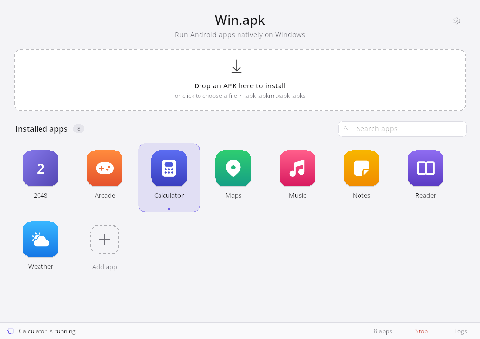
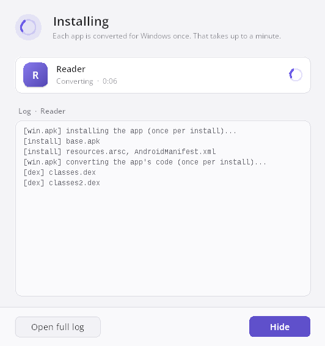
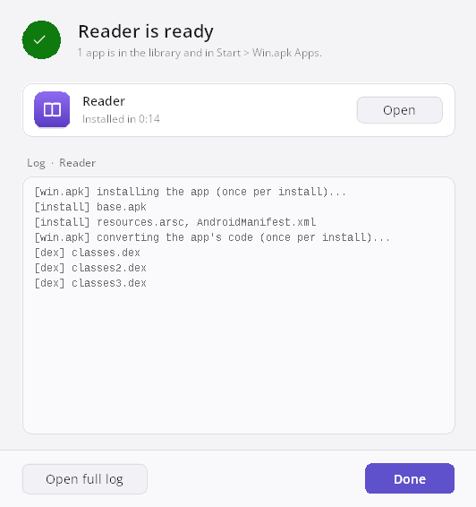
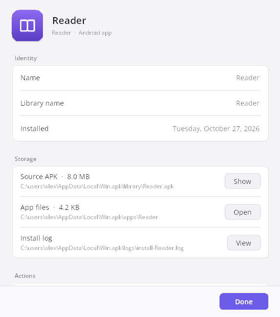
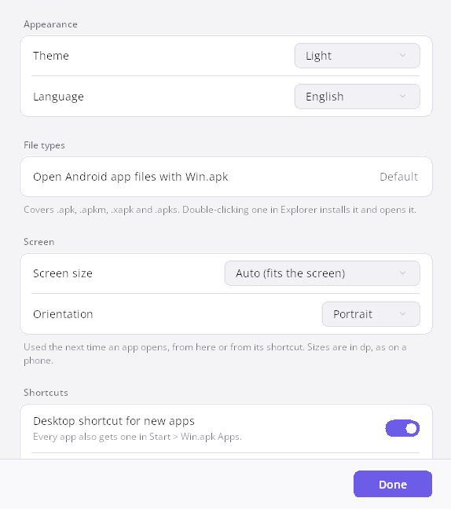
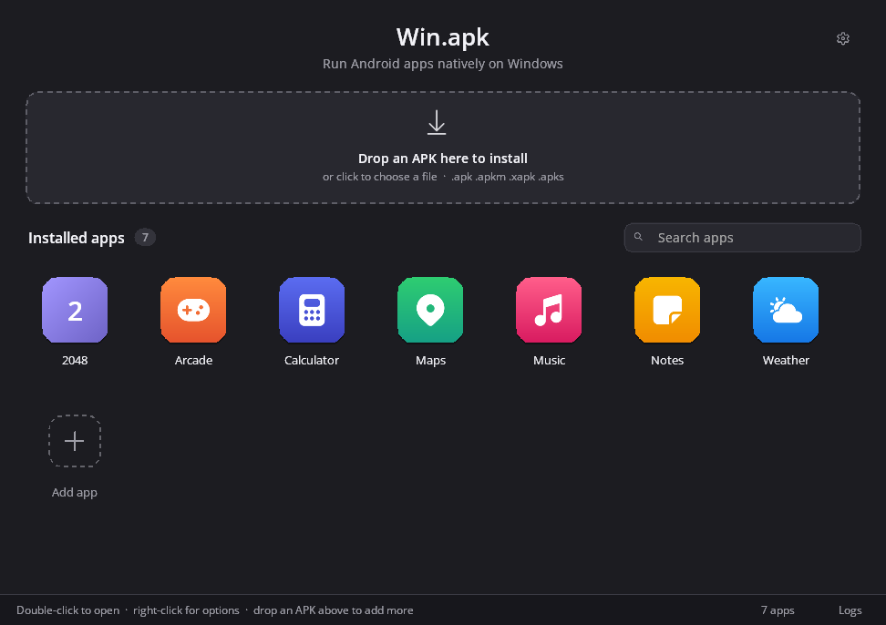
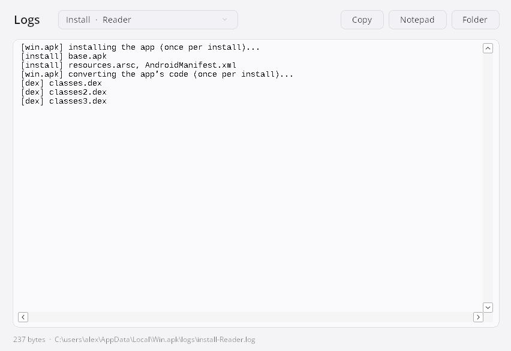

# Win.apk

**Run Android apps on Windows 10 and 11 (x64), as ordinary Windows programs.**

[](../../releases)
[](#requirements)
[](LICENSE)

Win.apk installs Android apps (`.apk`, `.apkm`, `.xapk`, `.apks`) and runs each
one in its own window, with its own icon in the Start menu. There is no
emulator and no virtual machine: an app's Java code runs on a real Java VM,
its x86_64 native libraries load directly into the process, and its graphics
go through ANGLE on Direct3D 11.



> **Early preview.** Many Java/Kotlin apps already run well; native-heavy apps
> and games are partly there. Check [what works](#what-works) before you try.

## Contents

- [Features](#features)
- [Requirements](#requirements)
- [Install](#install)
- [Add an app](#add-an-app)
- [The Store](#the-store)
- [Open and manage apps](#open-and-manage-apps)
- [Settings](#settings)
- [Hebrew and right-to-left](#hebrew-and-right-to-left)
- [Logs and reporting a problem](#logs-and-reporting-a-problem)
- [What works](#what-works)
- [Where your data lives](#where-your-data-lives)
- [Command line](#command-line)
- [Build from source](#build-from-source)
- [Repository layout](#repository-layout)
- [Credits](#credits)
- [License](#license)

## Features

- **One library for your Android apps.** Drop an APK on the window to install
  it; every app gets a tile with its own icon, a Start menu shortcut and,
  if you want, a desktop shortcut.
- **A built-in store.** The Store tab lists the free and open-source apps on
  [F-Droid](https://f-droid.org) that run here: search, pick a category,
  click **Install**.
- **Bundles too.** Split APKs as `.apkm`, `.xapk` and `.apks` install like a
  plain `.apk`.
- **Install progress you can see.** A window shows each app in the queue, how
  long it has been converting, and its log as it is written.
- **Per-app tools.** Get Info, update from a newer APK, reinstall, open the
  app's files, remove it (what it saved stays).
- **Live log viewer** for every install and run.
- **Light and dark themes**, following Windows or set by hand.
- **English and Hebrew**, with a full right-to-left layout in Hebrew.
- **Phone size and orientation** for apps, set once in the settings.
- **Per-user install.** No administrator rights, nothing outside your user
  profile.

## Requirements

- Windows 10 or 11, 64-bit (x64). Windows on ARM is untested.
- Disk space for Win.apk (it includes its own Java runtime and ANGLE) and for
  the apps you install.
- A GPU with Direct3D 11 is best. Without one, a software renderer takes over.

Nothing else needs to be installed.

## Install

1. Open the [Releases](../../releases) page and download `Win.apk-Setup.exe`
   from the newest release.
2. Run it. It installs for your user only, into
   `%LOCALAPPDATA%\Programs\Win.apk`, and asks no administrator questions.
   Tick **Put Win.apk on the desktop** if you want a desktop icon.
3. Windows SmartScreen may say **"Windows protected your PC"**, because the
   installer is not signed yet. Click **More info**, then **Run anyway**.
4. Win.apk opens when setup finishes. Later, start it from the Start menu.

The installer also makes `.apk` files open with Win.apk, so double-clicking
one in Explorer installs and opens it.

**Portable:** prefer not to install? Download `Win.apk-windows-x64.zip`,
unzip it anywhere, and start `Win.apk.exe` from that folder.

**Uninstall:** Windows Settings → Apps → Installed apps → Win.apk →
Uninstall. Your apps and their data stay in `%LOCALAPPDATA%\Win.apk`; delete
that folder too to remove everything.

## Add an app

Any of these installs an app:

- drag one or more APK files onto the Win.apk window;
- click the drop zone, or the **Add app** tile, and choose the files;
- double-click an `.apk` in Explorer.

Win.apk keeps its own copy of the APK, so you can delete the download
afterwards. The first install of an app converts its code for Windows, which
takes up to a minute (more for very large apps); installs run one at a time.
A window follows the progress:

| While it installs | When it is done |
|---|---|
|  |  |

You can hide the window at any time; the drop zone and the app's tile keep
showing the progress.

## The Store

The **Store** tab, next to **Library** at the top of the window (Ctrl+2;
Ctrl+1 goes back), is [F-Droid](https://f-droid.org)'s catalog of free and
open-source apps, usually Java-only and a good place to start. It lists the
apps whose native code runs here (x86_64, or arm64 through translation),
newest updates first; type to search, or pick a category.

- **Install** downloads the app from f-droid.org, checks it against the
  SHA-256 in F-Droid's index (a file that does not match is not installed)
  and installs it like a dropped APK. The card shows the download and the
  install; then its button says **Open**.
- **Update** shows when F-Droid has a newer version of an app you have, by
  package, however you installed it. What the app saved stays.
- Click a card for its version, size, license and a link to its F-Droid page.

The first time, the Store downloads F-Droid's index (about 15 MB) and keeps a
summary of it; after that it opens at once and checks for new apps every few
hours in the background (F5 checks now). Win.apk opens on the Store while the
library is empty.

## Open and manage apps

- **Open an app:** double-click its tile, press Enter, or use its Start menu
  or desktop shortcut. A dot under the tile shows it is running; **Stop** at
  the bottom of the window closes it.
- **In an app:** the mouse is your finger and the wheel scrolls. Android's
  Back is **Escape**, **Alt+Left** or the mouse's back button. Closing the
  window quits the app.
- **Search:** just start typing in the library.
- **Right-click an app** for: Open, Get Info, Create desktop shortcut, Show
  the APK in Explorer, Open the app's files, Show the last log, Update from
  APK, Reinstall and Remove.

**Get Info** shows where the app and its files are, how big they are, and
its install log, with the same actions:



**Update from APK** installs a newer version over the old one and keeps the
app's saved data. **Remove** deletes the app and its shortcuts but keeps what
it saved, so installing it again picks up where it left off.

Keyboard: arrow keys move between apps, **Enter** opens, **Delete** removes,
**Ctrl+F** searches, **Ctrl+O** adds an app, **Ctrl+I** shows Get Info and
**Ctrl+,** opens the settings.

## Settings

Click the gear at the top right.



| Setting | What it does |
|---|---|
| **Theme** | Match Windows, Light or Dark |
| **Language** | Match Windows, English or Hebrew |
| **Open Android app files with Win.apk** | Makes Win.apk the default for `.apk`, `.apkm`, `.xapk` and `.apks` |
| **Screen size** | The phone screen apps see, in dp. **Auto** fits the screen (360 × 800 or shorter) |
| **Orientation** | Portrait or landscape |
| **Desktop shortcut for new apps** | Every app gets a Start menu shortcut; this adds one on the desktop too |
| **Shortcuts → Recreate** | Makes every app's Start menu shortcut again |
| **Logs**, **App data** | Open the log viewer or the folders |
| **Remove all apps** | Removes every app, keeping what they saved |

Screen size and orientation apply the next time an app opens.

The dark theme:



## Hebrew and right-to-left

Win.apk speaks English and Hebrew. When Windows' display language is Hebrew,
it opens in Hebrew; otherwise pick **Language → עברית** in the settings, and
it switches at once. In Hebrew every window is laid out right to left: the
library, the settings, Get Info, the install window, menus and dialogs. Logs
stay left to right.

## Logs and reporting a problem

Click **Logs** at the bottom of the library to open the log viewer. It shows
any of Win.apk's logs and follows the end as the runtime writes it:



- `last-run.log` is the app opened most recently.
- `install-<app>.log` is that app's install.

If an app does not start or misbehaves, [open an issue](../../issues/new) with
the app's name and version, what happened, and the log (**Copy** puts it on
the clipboard). The most useful lines:

| Line | Meaning |
|---|---|
| `native not implemented` | A Windows piece that is still missing |
| `not implemented on Windows yet` | A system function the app's native code needs |
| `Exception` or `FATAL` | The app crashed |

## What works

| Works | Not yet |
|---|---|
| Java/Kotlin apps, in their own window, with mouse, wheel and keyboard | Apps with 32-bit ARM native code only (`lib/armeabi-v7a`) |
| OpenGL ES from Java (`GLSurfaceView`, libGDX) and from native code (SDL games) | `NativeActivity` games |
| Apps that ship `lib/x86_64` native libraries | MediaPlayer, OpenSL ES and AAudio |
| Apps with ARM native code only (`lib/arm64-v8a`), translated to x64 (below) | |
| Sound from Java (AudioTrack, SoundPool: WAV, Ogg, MP3) | Video, camera, WebView, location |
| Files, SharedPreferences, SQLite, clipboard, file pickers, game controllers | Google Play services (sign-in, purchases, maps) |

Why the split: Android phones are ARM, while these PCs are x64. Java code
and x86_64 libraries run directly. An app's 64-bit ARM libraries
(`lib/arm64-v8a`) are translated to x64 once, when the app is
installed: `winapk-aot` turns each library into C and clang compiles it
for your CPU (`<lib>.so.aot.dll`, next to the library). That code runs at
close to native speed. What the translation cannot follow, or every library
when no clang is found, runs through an ARM JIT instead, which is slower.
Apps are installed with the ABIs `x86_64,arm64-v8a`, so an app's x86_64 build
is used when it has one. 32-bit ARM (`armeabi-v7a`) is not supported.

The translation needs clang: Win.apk uses `WINAPK_AOT_CLANG`, a
`clang\bin\clang.exe` in Win.apk's folder, a `clang.exe` on the PATH, or an
LLVM or MSYS2 (`C:\msys64\clang64`) install, in that order.

## Where your data lives

| What | Where |
|---|---|
| Win.apk itself | `%LOCALAPPDATA%\Programs\Win.apk` (installer) or the folder you unzipped |
| Installed apps (Win.apk's copy of each APK) | `%LOCALAPPDATA%\Win.apk\library` |
| Each app's converted code, icon and name | `%LOCALAPPDATA%\Win.apk\apps\<app>` |
| What the apps save | `%LOCALAPPDATA%\Win.apk\android` |
| Logs | `%LOCALAPPDATA%\Win.apk\logs` |
| The Store's catalog and icons | `%LOCALAPPDATA%\Win.apk\store` |
| Settings | `HKEY_CURRENT_USER\Software\Win.apk` |
| Start menu shortcuts | Start → Win.apk Apps |

## Command line

```bat
Win.apk.exe                         :: the library
Win.apk.exe app.apk                 :: install app.apk, then open it
Win.apk.exe --run <library apk>     :: open an installed app (what its shortcuts do)
```

The runtime can also be run directly, for testing:

```bat
bin\winapk-runtime.exe --apk app.apk [--install-only] [--data <dir>] [--jdk <dir>] [--lib <dir>]
```

| Environment variable | Effect |
|---|---|
| `WINAPK_PHONE_SIZE=412x915` | The phone size in dp (the library's Screen size setting sets this) |
| `WINAPK_HEADLESS=1` | Run without a window, for tests |
| `WINAPK_HEADLESS_FRAME=frame.bmp` | Save the last frame the app drew |
| `WINAPK_HEADLESS_EXIT_AFTER_FRAMES=30` | Exit that many frames after the first |

## Build from source

Win.apk builds with **clang only** (MSVC cannot emit the System V calls Android
code needs). On Windows, in an [MSYS2](https://www.msys2.org/) **CLANG64**
shell:

```sh
pacman -S mingw-w64-clang-x86_64-{clang,cmake,ninja}
cmake -S windows -B build -G Ninja -DCMAKE_BUILD_TYPE=Release
cmake --build build
```

That builds the loader, the tests, `winapk-runtime.exe` and `Win.apk.exe`.
The Android framework is Java, built with a stock JDK by
`windows/scripts/build_java.sh`; `windows/scripts/stage_runtime.sh` puts
everything into a runnable folder. On Linux you can cross-compile and run the
tests under Wine. [`windows/README.md`](windows/README.md) has every step,
the tests and the CI.

**Releases** are made by running the **Windows release** workflow by hand
(Actions → Windows release → Run workflow) with a tag such as
`v0.2.0-preview`. It builds on Windows, smoke-tests the package, builds the
installer with Inno Setup and publishes a pre-release. Nothing is released
automatically.

## Repository layout

| Path | What it is |
|---|---|
| `windows/` | Win.apk itself: the ELF loader and Bionic shim, the JNI bridge, the Windows host (window, input, ANGLE, audio), the runtime, the library app (`windows/launcher/`), the installer (`windows/package/`) and the tests |
| `runtime/` | The Android framework in Java and shared native sources, from Mac.apk |
| `scripts/build_framework_res.sh` | Builds the platform resource APK |
| `docs/` | The images in this README |
| `.github/workflows/` | Checks on pull requests, and the release workflow (run by hand) |

Design notes, findings and the milestone plan are in
[`windows/PORTING.md`](windows/PORTING.md). Contributions are welcome: see
[`CONTRIBUTING.md`](CONTRIBUTING.md). Security problems: see
[`SECURITY.md`](SECURITY.md).

## Credits

Win.apk started as a port of [Mac.apk](https://github.com/kksimp/Mac.apk) by
Kaleb Simpson / Voltare, and its Android runtime (`runtime/`) comes from
there. Win.apk is not affiliated with or endorsed by the Mac.apk project; the
Mac.apk name and logo belong to their owners ([`TRADEMARKS.md`](TRADEMARKS.md)).

It also builds on [ANGLE](https://chromium.googlesource.com/angle/angle),
[Eclipse Temurin](https://adoptium.net/) and the other components listed in
[`THIRD_PARTY_NOTICES.txt`](THIRD_PARTY_NOTICES.txt).

## License

[AGPL-3.0](LICENSE).
