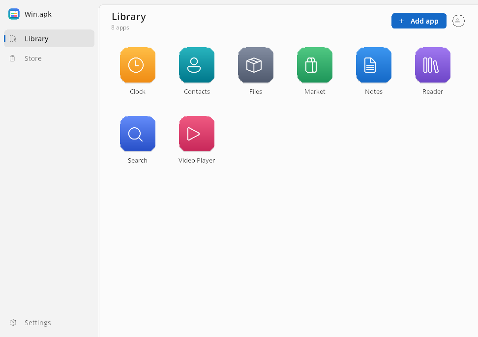

# Win.apk

**Run Android apps on Windows 10 and 11 (x64) as ordinary Windows programs.**

Win.apk installs Android apps (`.apk`, `.apkm`, `.xapk`, `.apks`) and runs
each one in its own window, with its own Start menu entry. There is no
emulator and no virtual machine: an app's Java code runs on a standard Java
VM, its native libraries load into the same process, and its graphics go
through ANGLE on Direct3D 11.

Win.apk is an unofficial port of [Mac.apk](https://github.com/kksimp/Mac.apk)
to Windows x64. It is not affiliated with or endorsed by the Mac.apk project.

> **Early preview.** Many Java and Kotlin apps run well; native-heavy apps and
> games are partly there. See [What works](#what-works) and
> [`docs/APPS.md`](docs/APPS.md) before you try an app.

## Contents

- [The problem it solves](#the-problem-it-solves)
- [How it works](#how-it-works)
- [Requirements](#requirements)
- [Install](#install)
- [First run](#first-run)
- [What works](#what-works)
- [Where your data lives](#where-your-data-lives)
- [Getting help](#getting-help)
- [Documentation](#documentation)
- [Contributing](#contributing)
- [Credits](#credits)
- [License](#license)

## The problem it solves

Android apps are built for phones: ARM processors, a Linux kernel, Android's
own C library (Bionic) and its Java framework. A Windows PC has none of these.
The usual answer is an emulator or a virtual machine running a whole Android
system, which is heavy, slow to start, and keeps the apps in a separate box.

Win.apk takes the other route, the one Mac.apk took on Apple Silicon: it
re-creates the Android application environment on top of Windows. Each app
becomes a normal Windows process with a normal window, a taskbar icon and a
Start menu shortcut, and it shares the user's Downloads, Pictures and other
folders.

## How it works

| Stage | What happens |
|---|---|
| **Install** (once per app) | The APK or bundle is unpacked into the layout an Android device uses. Its DEX bytecode is converted to Java class files. Its icon and name are extracted for the library. ARM-only native libraries start being translated to x64 in the background. |
| **Java code** | Runs on a standard HotSpot JVM (bundled Eclipse Temurin 21) against a reimplementation of the Android framework in Java (from Mac.apk). |
| **Native code** (`.so` files) | x86_64 libraries are loaded by Win.apk's own ELF loader and call a Windows implementation of Android's C library (the Bionic shim). Calls between the Microsoft and System V calling conventions are bridged by generated thunks. ARM64-only libraries are translated to C and compiled with clang for the PC's CPU; until the translation is ready they run on an ARM64 JIT. |
| **Window and devices** | A Win32 window per app. OpenGL ES on ANGLE (Direct3D 11, with software fallbacks), audio on WASAPI, web content on WebView2, webcams and media decoding on Media Foundation, location from Windows, file pickers, clipboard, game controllers. |
| **Permissions** | Apps ask for permissions as on Android, in a Windows dialog. The answers are signed and stored per app. |

[`docs/ARCHITECTURE.md`](docs/ARCHITECTURE.md) explains each layer.

## Requirements

- Windows 10 or 11, 64-bit (x64). Windows on ARM is untested.
- A GPU with Direct3D 11 is best. Without one, a software renderer takes over.
- For web content inside apps and for Google sign-in: the Microsoft Edge
  WebView2 Runtime, which Windows 11 and most Windows 10 PCs already have.
- Disk space for Win.apk (it bundles a Java runtime, ANGLE and a clang
  compiler) and for the apps you install.

Nothing else needs to be installed.

## Install

1. Download `Win.apk-Setup.exe` from the newest [release](../../releases).
2. Run it. It installs for your user only, into
   `%LOCALAPPDATA%\Programs\Win.apk`, and needs no administrator rights.
3. Windows SmartScreen may warn that the installer is not signed. Click
   **More info**, then **Run anyway**.

The installer adds Win.apk to the Start menu, makes `.apk` files open with it,
and speaks English or Hebrew according to the Windows display language.

**Portable:** download `Win.apk-windows-x64.zip` instead, unzip it anywhere,
and start `Win.apk.exe`.

**Uninstall:** Windows Settings > Apps > Installed apps > Win.apk. Your apps
and their data stay in `%LOCALAPPDATA%\Win.apk`; delete that folder to remove
everything.

## First run

1. Open Win.apk. It shows your library, empty at first, and the **Store**
   tab with F-Droid's free and open-source apps.
2. Add an app: drop an APK on the window, pick one in the Store and click
   **Install**, or double-click an `.apk` in Explorer. The first install of an
   app converts its code, which takes up to a minute.
3. Double-click the app to open it. In the app, the mouse is your finger,
   the wheel scrolls, and Escape is Android's Back.

The [user guide](docs/USER_GUIDE.md) covers everything else: the Store,
per-app actions, settings, orientation and window size, Hebrew, permissions,
the Google account, logs and troubleshooting.

## What works

| Works | Not yet |
|---|---|
| Java and Kotlin apps, each in its own resizable window, with mouse, wheel and keyboard | Apps with only 32-bit ARM native code (`lib/armeabi-v7a`) |
| OpenGL ES from Java (`GLSurfaceView`, libGDX) and from native code (SDL games); `NativeActivity` apps | Vulkan |
| Apps that ship `lib/x86_64` libraries (loaded directly), and apps with only `lib/arm64-v8a` libraries (translated) | Video playback (MediaPlayer video, ExoPlayer, the NDK media API) |
| Sound: AudioTrack, SoundPool and MediaPlayer audio from Java; AAudio from native code; the microphone | OpenSL ES from native code (engines that use it get no sound) |
| Files, SharedPreferences, SQLite; shared storage mapped to your Windows folders | Sensors (accelerometer and the like) |
| WebView and Custom Tabs on WebView2 | Play Store features: in-app purchases, Play Integrity, the Maps SDK's map |
| Webcams, location, clipboard, file pickers, game controllers | Notifications: an app may post them, but they are not shown |
| Permission dialogs for every Android permission group | |
| Google sign-in, and the Play services apps use for licences, push messages, Firebase Analytics and location | |

Every row has a counterpart in the code; the
[architecture document](docs/ARCHITECTURE.md) says where.
[`docs/APPS.md`](docs/APPS.md) lists known issues by kind of app and the apps
people have tried; please add yours.

## Where your data lives

| What | Where |
|---|---|
| Win.apk itself | `%LOCALAPPDATA%\Programs\Win.apk` (installer) or the folder you unzipped |
| Your copy of each APK, with the app's name and per-app choices | `%LOCALAPPDATA%\Win.apk\library` |
| Each app's converted code, icon and name | `%LOCALAPPDATA%\Win.apk\apps\<app>` |
| What the apps save (the Android file system) | `%LOCALAPPDATA%\Win.apk\android` |
| Logs | `%LOCALAPPDATA%\Win.apk\logs` |
| Settings | `HKEY_CURRENT_USER\Software\Win.apk` |
| Start menu shortcuts | Start > Win.apk Apps |

The [user guide](docs/USER_GUIDE.md#where-things-are) has the full list.

## Getting help

1. Look in [`docs/APPS.md`](docs/APPS.md) for the app or the kind of problem.
2. Open **Logs** at the bottom of the library and read the end of
   `last-run.log`; the [troubleshooting section](docs/USER_GUIDE.md#troubleshooting)
   says what the common lines mean.
3. [Open an issue](../../issues/new/choose) with the "An app does not work"
   template: the app's name, version and source, the exact steps, a screenshot,
   and the whole log. Hebrew is fine.

Security problems: see [`SECURITY.md`](SECURITY.md), not a public issue.

## Documentation

| Document | For whom | What it covers |
|---|---|---|
| [`docs/USER_GUIDE.md`](docs/USER_GUIDE.md) | Users | Installing apps, the Store, settings, permissions, the Google account, logs, troubleshooting, the command line |
| [`docs/APPS.md`](docs/APPS.md) | Users | Known issues by kind of app, and apps people have tried |
| [`docs/ARCHITECTURE.md`](docs/ARCHITECTURE.md) | Developers and the curious | How Win.apk works: each layer, an install and a run step by step, the data layout, the build and CI |
| [`windows/README.md`](windows/README.md) | Developers | Building, running and testing from source; every change made to the upstream `runtime/` tree |
| [`windows/PORTING.md`](windows/PORTING.md) | Developers | Design decisions, technical findings, known gaps and the milestone plan |
| [`CONTRIBUTING.md`](CONTRIBUTING.md) | Contributors | Reporting problems, adding apps to the list, sending code |

## Contributing

Report how an app runs, add a row to [`docs/APPS.md`](docs/APPS.md), or send
code: [`CONTRIBUTING.md`](CONTRIBUTING.md) has the rules (behave like Android,
no app-specific code, Windows code in `windows/`). If Win.apk is useful to
you, a star on the repository helps other people find it.

## Credits

Win.apk started as a port of [Mac.apk](https://github.com/kksimp/Mac.apk) by
Kaleb Simpson / Voltare, and its Android runtime (`runtime/`) comes from
there. Win.apk is not affiliated with or endorsed by the Mac.apk project; the
Mac.apk name and logo belong to their owners ([`TRADEMARKS.md`](TRADEMARKS.md)).

It also builds on [ANGLE](https://chromium.googlesource.com/angle/angle),
[Eclipse Temurin](https://adoptium.net/), [LLVM](https://llvm.org/) clang,
[dynarmic](https://github.com/azahar-emu/dynarmic) and the other components
listed in [`THIRD_PARTY_NOTICES.txt`](THIRD_PARTY_NOTICES.txt).

## License

[AGPL-3.0](LICENSE), like Mac.apk. Anyone who distributes a build, or offers a
modified version over a network, must provide the complete corresponding
source.
