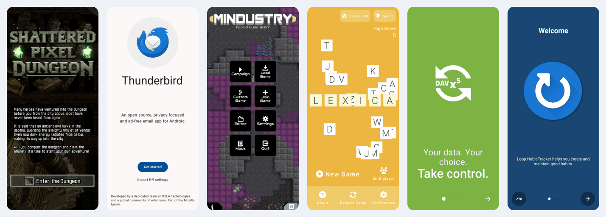

# Compatibility

What works in Win.apk, what works in part, and what is missing, in one place.
Every row was checked against the code of the current `main`; the source
column names the file to read when in doubt. Other pages link here instead of
keeping a copy.

**✅ works** · **⚠️ partly: read the note** · **❌ missing**

- [What works](#what-works)
- [Needs improvement, by importance](#needs-improvement-by-importance)
- [The automated sweep](#the-automated-sweep)
- [Known issues by kind of app](#known-issues-by-kind-of-app)
- [Apps people have tried](#apps-people-have-tried)

## What works

### Installing and running

| Area | | What exactly | What is missing | Source |
|---|:-:|---|---|---|
| App files | ✅ | `.apk`, and the split bundles `.apkm` (APKMirror), `.xapk` (APKPure) and `.apks` (bundletool); the splits for this PC are picked as Android's installer picks them | | `windows/host/runtime_main.cpp` |
| Java and Kotlin apps | ✅ | Each in its own resizable window, with a Start menu shortcut and a taskbar icon | | `win32_window.cpp` |
| Native code: x86_64 | ✅ | `lib/x86_64` libraries load directly, at full speed | | `windows/src/` |
| Native code: arm64-v8a only | ⚠️ | Translated to x64 in the background; the app runs on a slower ARM JIT until then. See [ARM apps](arm-apps.md) | A library over 1 million instructions is translated only where the app ran | `winapk-aot`, `src/arm64/` |
| Native code: armeabi-v7a only | ❌ | | 32-bit ARM code does not run. Look for another build of the app | |
| Input | ⚠️ | Mouse as one finger; touchscreen fingers as Android pointers (up to 10); pen with pressure and eraser; the wheel and touchpad scroll as `ACTION_SCROLL`; Ctrl+wheel and the touchpad pinch as a two-finger pinch; right and middle buttons; hover; the keyboard with dead keys, AltGr and IME composition (TSF: the focused field is a text services document, reconversion included; IMM32 when TSF is not there); Windows' touch keyboard for a touched text field; Escape as Back; Xbox (XInput) controllers | Touch, pen, touchpad pinch and IME are checked by unit tests only, not yet on real hardware (the TSF document attaches and follows typing under Wine; a real IME's composition and the touch keyboard need real Windows). No pen tilt. Controllers that are not XInput | `win32_window.cpp`, `pointer_input.h`, `native_gamepad.cpp` |

### Graphics, sound and video

| Area | | What exactly | What is missing | Source |
|---|:-:|---|---|---|
| OpenGL ES | ✅ | GLES 1.1 to 3.2 and EGL 1.5, from Java (`GLSurfaceView`, libGDX, an app's own GL thread on EGL10 or EGL14, each drawing on its own thread as on Android) and from native code (SDL), on ANGLE over Direct3D 11; WARP or SwiftShader without a GPU | | `host/gl/` |
| `NativeActivity` | ✅ | Games whose whole UI is native code get their window, input queue and configuration | | `native_activity.cpp` |
| Vulkan | ❌ | | Not implemented | |
| Pictures (`BitmapFactory`, `ImageDecoder`) | ✅ | PNG, JPEG, WebP, GIF, BMP and ICO by Android's own decoders; HEIF/HEIC (a phone's photos) and AVIF through Windows | HEIF needs Microsoft's HEIF Image Extensions, AVIF its AV1 Video Extension (Microsoft Store); without them such a picture does not open, as on a phone that cannot read it | `windows/java/aosp_gfx/` (`HostImageDecode`), `native_image.cpp` |
| AudioTrack, SoundPool, MediaPlayer audio | ✅ | A WASAPI mixer; WAV, Ogg Vorbis, Ogg Opus (libopus), MP3, AAC and what Windows decodes | | `native_audio.cpp`, `audio_decode.cpp` |
| AAudio | ⚠️ | Output, in write and callback modes | No AAudio input | `native_aaudio.cpp` |
| Microphone (`AudioRecord`) | ✅ | WASAPI capture | | `native_audio_input.cpp` |
| OpenSL ES | ⚠️ | Buffer-queue PCM players (8-bit, 16/24/32-bit, float; mono to 7.1), players of a file descriptor (an asset's), a file or an http(s) URL, decoding to a buffer queue; volume, mute/solo, stereo position, playback rate, seek, loop, play and prefetch events; recorders on the microphone, with `RECORD_AUDIO` | No effects (reverb, equalizer, virtualizer, bass boost), MIDI, 3D, or http streams without an end. Checked by a unit test, not yet with a game (#132) | `native_opensles.cpp` |
| `MediaPlayer`, `VideoView` | ✅ | MP4, MOV, MKV with H.264 and AAC always; HEVC, VP9 and AV1 with Microsoft's codec packs; from a file or an http(s) URL | WebM, VP8/VP9/AV1 without the codec packs, Opus: the player is Media Foundation's alone (the built-in decoders serve `MediaCodec`) | `video_player.cpp` |
| `MediaCodec` (ExoPlayer and others) | ⚠️ | Decoding: H.264 video and the codec packs' formats (HEVC); VP8, VP9 (8 and 10-bit) and AV1 always, on Media Foundation's decoder when installed, else on the built-in libvpx and dav1d (software with SIMD, on every core; up to 4096 wide or tall); without a Surface the output buffer and Image hold I420, or P010 when asked for, with stride, crop and colour in the output format; AAC, MP3 and Opus (libopus, surround included) audio. Encoding: H.264 and AAC-LC on Windows' software encoders, from byte buffers, a camera2 session or a Canvas on the input Surface | Vorbis and FLAC audio (such a stream plays silent). HDR video (PQ, HLG) is shown as SDR, not tone-mapped, so the HDR profiles are not offered. No OpenGL ES input to an encoder, so screen and game recorders and GL filter pipelines record nothing. The encoders have run only in the unit test | `native_media_video.cpp`, `soft_codecs.cpp`, `native_media_codec.cpp`, `media_encode.cpp` |
| `MediaExtractor`, `MediaMuxer`, `MediaRecorder` | ⚠️ | Extractor: MP4, MOV tracks with H.264, HEVC, AAC, MP3; WebM and MKV (libwebm's mkvparser) with VP8, VP9, AV1, H.264, HEVC, Opus, Vorbis, AAC; from a file, URL (MP4/MOV), descriptor or `content://`. Muxer: MP4 and 3GPP with H.264 and AAC. Recorder: the microphone to AAC, a Surface (camera2) to H.264 | A WebM from an http(s) URL; WebM and Ogg output; AMR, Opus encoding; the old `Camera` API as a recorder's source; tags and embedded pictures in `MediaMetadataRetriever` | `video_decode.cpp`, `webm_demux.cpp`, `mp4_writer.cpp` |
| NDK media (`AMediaCodec`, `AMediaExtractor`) | ⚠️ | Decoders, on the same decoders as `MediaCodec`: H.264, HEVC with the codec pack, VP8, VP9 and AV1 (built in where Media Foundation has none), AAC, MP3 and Opus; output buffers of I420 (P010 when asked for) or 16-bit PCM, or pictures shown on the app's native window; codec data from the format or as `BUFFER_FLAG_CODEC_CONFIG` buffers; synchronous and asynchronous (`setAsyncNotifyCallback`) use. The extractor and `AMediaDataSource`: a file, an http(s) URL, a descriptor's range (an asset) or the app's own data source, the same containers as `MediaExtractor` | No encoder (`createEncoderByType` is null), no secure decoder or `AMediaCrypto`, no input surface, no `AMediaMuxer`; a picture released for a time is shown at once. Checked by a unit test, not yet with an app (#133) | `ndk_media_codec.cpp`, `native_media.cpp` |

### The PC's hardware

| Area | | What exactly | What is missing | Source |
|---|:-:|---|---|---|
| Camera | ✅ | Webcams through Camera, camera2 and CameraX (Media Foundation), each offered as a back and a front camera (by design, so apps that want the rear camera work); a virtual camera when there is none. Preview, analysis frames and JPEG stills; video through `MediaRecorder` or an encoder's Surface from camera2. The camera's orientation follows the window's (90° in landscape), so apps' own rotation comes out at none for the upright webcam picture. Autofocus where the webcam's driver offers it (camera1's "auto" and continuous modes with a real one-shot focus, camera2's AF modes and states, `android.hardware.camera.autofocus`); otherwise a fixed-focus camera. A torch only where the driver has one. The system camera's capture screen (`ACTION_IMAGE_CAPTURE`): a window on the webcam with Take photo, or a picture file chosen instead | Focus and torch have not been tried on a real webcam yet (written to the drivers' documented controls; the unit test covers the fixed-focus path). No zoom, face detection, exposure or white-balance control | `native_camera.cpp`, `CameraBridge.java`, `CameraCaptureHandler.java` |
| NDK camera (`ACameraManager`, `AImageReader`) | ⚠️ | The same webcams for an app's native code (libcamera2ndk), numbered as camera2 numbers them: characteristics as camera2 has them, `openCamera` behind the CAMERA permission, capture sessions with repeating and one-shot requests, their results and callbacks; outputs to `AImageReader` (YUV_420_888 semiplanar, RGBA_8888, JPEG) or the app's native window; continuous autofocus and the torch where the webcam has them | Checked by a unit test on a stand-in camera, not yet with an app or a real webcam. The camera captures at one size (the largest reader's; a smaller reader gets it scaled); no exposure, white balance or zoom control (LEGACY); a window from an `ASurfaceTexture` gets no pictures; no shared or physical outputs | `ndk_camera.cpp`, `camera_host.h` |
| Cheque deposit (Israeli banks) | ⚠️ | Hapoalim, Leumi and Mercantile scan cheques with Scanovate's scanner on the old `Camera` API: camera 0 (a back camera here), a SurfaceView preview, NV21 preview frames, a landscape-only scan screen. It turns the preview by (`CameraInfo.orientation` − rotation × 90) mod 360, which is 0 here in both orientations (`CameraOrientationTest`); it autofocuses only when `android.hardware.camera.autofocus` is declared and "auto" is listed, which follows the webcam; it prefers 1280×720 | Not yet tried in the banks' apps on a real webcam. Its native code rejects blurry frames, so a webcam that cannot focus close (most fixed-focus ones) may never accept a cheque; it needs one that autofocuses at short range and does 1280×720 | `native_camera.cpp`, `Camera.java` |
| Location | ✅ | Windows' location service, behind Windows' privacy switch | | `native_location.cpp` |
| Sensors | ❌ | | None of the PC's sensors is passed on, and none is made up: no accelerometer, gyroscope or any other sensor is reported (as on an Android device without them), so tilt games find none. Windows' own sensor API (2-in-1s) is not wired | `runtime/java/android/hardware/SensorManager.java`, `native_sensor.cpp` |
| Bluetooth | ⚠️ | Paired devices; serial (RFCOMM) connections both ways; LE scans and the GATT client (read, write, notifications) | Discovery and pairing from the app, LE advertising, the GATT server, audio and HID profiles, L2CAP | `native_bluetooth.cpp` |
| Wi-Fi and the network | ⚠️ | On or off, the current network, the DHCP configuration, scan results; `ConnectivityManager` reports the PC's real default adapter (cable or Wi-Fi), its addresses and DNS servers; multicast and broadcast sockets for finding devices on the local network | Connecting the PC to a network (a device's own setup hotspot); `NsdManager` (mDNS) reports failure | `native_radios.cpp`, `src/bionic/socket.cpp` |
| Clipboard, file pickers | ✅ | Text, HTML and links; Windows' open and save dialogs | | `native_clipboard.cpp`, `native_picker.cpp` |

### Windows integration

| Area | | What exactly | What is missing | Source |
|---|:-:|---|---|---|
| WebView, Custom Tabs | ✅ | Microsoft Edge WebView2, with `shouldInterceptRequest` (Cordova, Capacitor); `file:///android_asset/` and `file:///android_res/` served from the APK, the app's own files with `setAllowFileAccess`; a download goes to the app's `DownloadListener`, never saved by the engine | Needs the WebView2 Runtime, which Windows 11 and most Windows 10 PCs have. A `file:` page's script sees an https origin (`location.protocol` is `https:`) | `native_webview.cpp`, `webview_file_urls.h` |
| Notifications | ⚠️ | Windows notifications with the app's name and icon, text, large icon and progress; a click opens the app while it runs | Action buttons are not shown | `native_notifications.cpp` |
| Storage | ✅ | Files, SharedPreferences, SQLite. Downloads, Pictures, Documents, Music and Movies are your Windows folders (a setting turns this off) | | `user_folders.cpp` |
| Permissions | ✅ | Android's dialogs for every dangerous group and special access, remembered per app | | `launcher_main.cpp` (`appops`) |
| Screen readers | ⚠️ | Narrator, NVDA and other UI Automation readers read an app's views from Android's accessibility nodes (names as TalkBack speaks them, roles, states, values, lists' positions, Compose's semantics), in Android's reading order and the app's language; they can press, toggle, type, select, set a slider, expand and collapse, scroll, and read a field by character, word and line; focus, live regions, announcements and toasts are spoken | Checked by unit tests, a UI Automation client and AOSP's views on a JVM; not yet tried with Narrator, NVDA or JAWS on real apps | `uia_tree.cpp`, `uia_provider.cpp`, `HostAccessibility.java`, `AccessibilityTree.java` |
| Hebrew and right to left | ⚠️ | Win.apk itself and its installer are fully Hebrew and mirrored. Apps see the Windows language and region, and the framework lays out right-to-left apps as Android does | Few Hebrew apps have been tried by hand | `launcher_main.cpp` (`tr()`) |

### Google and app stores

| Area | | What exactly | What is missing | Source |
|---|:-:|---|---|---|
| Google sign-in and basic Play services | ✅ | Built-in stand-ins: Google sign-in, Play licence checks, push messages (FCM), Firebase Analytics, fused location | | `runtime/java/com/macapk/gms/` |
| Google's real Play services and Play Store | ⚠️ | Experimental, off by default, with Google's own APKs that you install. Tried: FCM tokens, the Play Store signed in, installing a free app from it. See [Google services](google-services.md) | Untested on most apps | `binder_win.cpp`, `SystemServer` |
| In-app purchases, Play Integrity, Maps SDK | ❌ | | Billing reports unavailable, there is no attestation, and the Maps SDK lays out a blank map (the app itself starts and runs; the map never reports ready). Not planned: Win.apk does not forge Google's checks | |
| The built-in Store (Win.apk's own store app) | ⚠️ | Shown in the Win.apk window; got from its GitHub release at the first opening and updated with the daily check, kept only at GitHub's size and SHA-256; allowed to install apps from the start; its installs go through the install window and name it as their installer | New: checked under Wine (got, shown, an app installed from it), not yet on Windows | `launcher_main.cpp` (the Store), `store_app.h` |
| Other store apps (F-Droid's app, Droid-ify, Aurora Store) | ⚠️ | An app that installs other apps goes through Android's steps: "Install unknown apps" for it the first time, "Do you want to install this app?", then the install window with its progress and "App installed." with Open and Done (or the reason it failed) | Being tested in [#66](https://github.com/israel2176/win.apk/issues/66) | `PackageInstallerBackend` |

## Needs improvement, by importance

Ordered by how many apps each gap blocks, as far as we know. An item without an
issue has none yet; please open one before working on it.

| # | Gap | Effect | Issue |
|---|---|---|---|
| 1 | The NDK media API, Vorbis/FLAC in `MediaCodec`, WebM in `MediaPlayer` | Video from native code does not play; some streams play without sound | |
| 2 | 32-bit ARM code (`armeabi-v7a`) | Apps that ship only 32-bit ARM libraries do not run at all | |
| 3 | Vulkan | Games that need Vulkan do not draw | |
| 4 | Notification action buttons | Reply, mark as read and similar buttons are missing | |
| 5 | Multi-touch on real hardware | Touchscreen fingers, pen and the touchpad pinch are passed on as Android pointers, but are checked by unit tests only; with a mouse alone, Ctrl+wheel is the only two-finger gesture | |
| 6 | Code signing | SmartScreen and some antivirus programs warn about the downloads | |
| 7 | Real sensors | PCs with an accelerometer cannot steer tilt games | |
| 8 | Bluetooth: discovery, pairing, GATT server, profiles | Apps that pair devices themselves or act as a Bluetooth peripheral | |
| 9 | Child processes: `fork`, a component's own `android:process` without Google services, passing file descriptors | Browsers that run their engine in separate processes (Firefox family) end at start. An x86_64 program an app runs (`posix_spawn`, `exec`, `ProcessBuilder`) runs | [#117](https://github.com/israel2176/win.apk/issues/117) |

## The automated sweep

CI can boot a corpus of 92 open-source F-Droid apps headless on Windows, one
per kind of app (Java-only, Kotlin and Compose, x86_64 native code, arm64-only,
games, Flutter, React Native, WebView), and report whether each draws its
first screen. The list is `windows/test/compat/apps.txt`; every pull request
that touches the runtime boots ten of them (`smoke.txt`) and fails if one no
longer draws.

The last full run (2026-11-25, [CI run 45643144404](https://github.com/israel2176/win.apk/actions/runs/45643144404)):
**81 of 92 drew their first screen.** Nine of the eleven that did not threw
on their main thread at start because AOSP's own `Activity`, `ActivityThread`
or widgets called something Win.apk's framework lacked:
`AttributionSource.getRenouncedPermissions`, which every runtime-permission
request reads (Diary, SatStat, F-Droid, Fossify Gallery, DroidFish, NewPipe),
`SplashScreen.SplashScreenImpl` (Organic Maps), `DateFormat.hasSeconds`
(Fossify Clock), or a `GLSurfaceView` that lost its XML id (Shader Editor);
the runtime then swallowed the exception, so the activity never finished
starting and its window stayed empty. AnkiDroid's crash reporter closed it
over a null `ActivityThread.sMainThreadHandler`. All ten are fixed and draw
under Wine. The main thread no longer swallows an exception: a gap of this
kind is now a crash, with Android's **has stopped** dialog and a
`FATAL EXCEPTION` in the log, as on a phone. MuPDF opens the system's
document picker as its first screen; the sweep runs with no user, nothing
answers the picker and the app's own window never draws. A person sees
Windows' Open dialog there. Open Sudoku is pinned at 4.11.1: 4.11.2 and 4.11.3
crash on a fresh install on a phone too ([#121](https://github.com/israel2176/win.apk/issues/121)).



A sweep result means the app started and drew. It does not mean every screen
works: a row in [Apps people have tried](#apps-people-have-tried) is worth more.

The arm64 translation was also run (2026-11-06) on the arm64-v8a builds of 28
F-Droid apps, each on the JIT alone and translated. 20 drew the same on both,
among them VLC, Jitsi Meet, LocalSend, Lichess, Godot, OsmAnd, Telegram X,
Minetest, Wesnoth, LibreOffice Viewer and Kodi. PPSSPP, Linphone and Emacs
crashed at start, GNU Backgammon and AAAAXY stopped, and Firefox, GCompris and
SimpleX drew nothing, the same way on both engines, so not because of the
translation.

## Known issues by kind of app

These come from how Win.apk is built, not from one app. The first column is
what to look for in the app or in its log.

| Sign | What it is | Workaround |
|---|---|---|
| The install says the app is built only for 32-bit ARM (`INSTALL_FAILED_NO_MATCHING_ABIS` in the install log) | 32-bit ARM code, which Win.apk cannot run: the install is refused, as on a phone with no ARM support | Find an x86_64 or arm64-v8a build ([which build](arm-apps.md#which-build-to-install)) |
| The APK has only `lib/arm64-v8a` | Runs, slowly at first, while it is translated | Give it a few minutes on its first runs |
| A video plays without sound in an ExoPlayer app | Vorbis or FLAC audio | Pick a stream with AAC or Opus audio, if the app lets you |
| "Sign in with Google" fails, or the app says Play services are missing | The app checks for Google's own Play services | Try [Google services](google-services.md) (experimental) |
| In-app purchases, a Play Integrity error, a blank Google map | Not available | Use an open-source build without Play services, where there is one |
| `not implemented on Windows yet` in the log | A C library function the app's native code needs | [Report it](troubleshooting.md#reporting-a-problem) with the log; adding one is usually small |
| `native not implemented` in the log | A piece of the Android host that is still missing | Report it with the log |
| `[win.apk] cannot load <library>` in the log | A native library the loader could not load: packed, encrypted, or for another CPU | Report it with the log and the APK's `lib/` folders |
| The app opens sideways, or narrow | Apps open in landscape; an app that fixes portrait opens portrait | The app's details page, **Window > Orientation**; or Settings > Apps > Default orientation for all apps |
| **Wiz has stopped** or **Wiz keeps stopping** | The app crashed: an error it did not handle. When its log's `FATAL EXCEPTION` is a `NoSuchMethodError` or `NoClassDefFoundError` naming an `android.` class, Win.apk's framework lacks something the app or Android's own code calls | [Report it](troubleshooting.md#reporting-a-problem) with the log (**Report a problem** under the message) |
| **Wiz isn't responding** | The app's main thread did not take a click or key for five seconds | **Wait** once; if it comes back each time at the same place, report it with the log |
| An app opens Windows' Open dialog before its own screen | The app's first screen is Android's document picker (MuPDF) | Pick a file there: the app opens it |
| SmartScreen or an antivirus warns | Win.apk is not code-signed yet, and Win.apk writes then runs translated code | Allow it if you downloaded Win.apk from this repository |

## Apps people have tried

One row per app and version that someone actually used. Newest test first
within an app. The results of [#69](https://github.com/israel2176/win.apk/issues/69)
(20 very different apps) are added here. The rows dated 2026-11-10 are
from the app probe (a by-hand workflow, since retired): each app a minute in
a window on a Windows machine without a graphics card, looked at in
screenshots and its log. Nobody used the app, so the status is *Boots* at
most.

**Status:** *Works* (the main screens are usable), *Partly* (opens, but
something in the notes does not work), *Boots* (draws its first screen in an
automated run; nobody has used it), *Does not start*, *Does not install*.

| App | Version | Source | Status | Notes | Tested | Issue |
|---|---|---|---|---|---|---|
| Markor | 163 (`net.gsantner.markor`) | F-Droid | Boots | Draws its first-run pages (the notebook's files); idle afterwards (0% of a processor) | 2026-11-10 | |
| Fossify Calendar | 24 (`org.fossify.calendar`) | F-Droid | Boots | Draws the month view with its header in one row; idle afterwards (1% of a processor). The header was laid out wrong until [#119](https://github.com/israel2176/win.apk/issues/119) was fixed | 2026-11-10 | |
| KeePassDX | 45500 (`com.kunzisoft.keepass.libre`) | F-Droid | Boots | Presents its first frame. Its window is hidden from screenshots, as the app asks, so the screen was not seen. On a first run its tutorial overlay pulses until it is tapped, which redraws the window on every frame (20% of a processor), as on a phone | 2026-11-10 | |
| Thunderbird | 33 (`net.thunderbird.android`) | F-Droid | Boots | Draws the welcome screen; idle afterwards | 2026-11-10 | |
| Telegram FOSS | | F-Droid | | Not tried: F-Droid no longer lists `org.telegram.messenger` | 2026-11-10 | |
| Fennec (Firefox) | 1590110 (`org.mozilla.fennec_fdroid`) | F-Droid | Does not start | Installs; ends about 15 s after the start, before a first frame. Gecko brings its own allocator and needs child processes, which the guest linker and the runtime do not serve yet | 2026-11-10 | [#117](https://github.com/israel2176/win.apk/issues/117) |
| VLC | 13070208 (`org.videolan.vlc`) | F-Droid | Boots | Draws the welcome screen; idle afterwards | 2026-11-10 | |
| Organic Maps | 26092932 (`app.organicmaps`) | F-Droid | Boots | Draws "Download the world overview map"; the map itself was not reached | 2026-11-10 | |
| Open Camera | 96 (`net.sourceforge.opencamera`) | F-Droid | Boots | Draws its first-run dialog over a black preview (the machine has no camera) | 2026-11-10 | |
| LocalSend | 641 (`org.localsend.localsend_app`) | F-Droid | Boots | Flutter: draws the Receive screen. Uses more than a whole processor while idle, on a machine without a graphics card | 2026-11-10 | |
| Jitsi Meet | 26000004 (`org.jitsi.meet`) | F-Droid | Boots | React Native: draws the room name screen with its tabs | 2026-11-10 | |
| Mindustry | 1115 (`io.anuke.mindustry`) | F-Droid | Boots | libGDX: draws the main menu. A whole processor while it shows, on a machine without a graphics card | 2026-11-10 | |
| DroidFish | 100 (`org.petero.droidfish`) | F-Droid | Boots | Draws the board with its pieces, clocks and buttons; idle afterwards. Its chess engine is a separate Android program and does not run. The pieces were missing until [#118](https://github.com/israel2176/win.apk/issues/118) was fixed | 2026-11-10 | |
| Privacy Friendly Sudoku | 101 (`org.secuso.privacyfriendlysudoku`) | F-Droid | Boots | Boots headless on every CI run: code conversion, `Application.onCreate`, the first activity and 30 frames | every CI run | |
| Klooni | 860 (`dev.lonami.klooni`) | F-Droid | Works | libGDX: OpenGL ES from Java; draws and takes input | `windows/PORTING.md`, section 8 | |
| Tensy | 2 (`se.voxelmanip.tensy`) | F-Droid | Works | SDL 3: OpenGL ES from native code through a SurfaceView; draws and takes input | `windows/PORTING.md`, section 8 | |

### Adding a row

Copy this line into the table, newest test first for the same app, and send it
as a pull request or in an issue ([CONTRIBUTING.md](../CONTRIBUTING.md)):

```
| App name | version (`package.name`) | F-Droid / APKMirror / the app's site | Works / Partly / Does not start | what works, what does not, in one line | YYYY-MM-DD | #123 |
```

- **Version:** as the app's About screen or its store page shows it, and the
  package name, so two apps with the same name are not confused.
- **Tested:** the date, and the Win.apk version if it is not the latest.
- **Issue:** the issue for anything that does not work.
