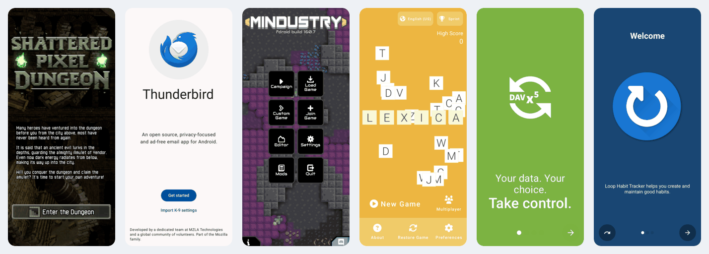

# Compatibility

What works in Win.apk, what works in part, and what is missing, in one place.
Every row was checked against the code of the current `main`; the source
column names the file to read when in doubt. Other pages link here instead of
keeping a copy.

**✅ works** · **⚠️ partly: read the note** · **❌ missing**

- [What works](#what-works)
- [Needs improvement, by importance](#needs-improvement-by-importance)
- [The automated sweep](#the-automated-sweep)
- [Known issues by kind of app](#known-issues-by-kind-of-app)
- [Apps people have tried](#apps-people-have-tried)

## What works

### Installing and running

| Area | | What exactly | What is missing | Source |
|---|:-:|---|---|---|
| App files | ✅ | `.apk`, and the split bundles `.apkm` (APKMirror), `.xapk` (APKPure) and `.apks` (bundletool); the splits for this PC are picked as Android's installer picks them | | `windows/host/runtime_main.cpp` |
| Java and Kotlin apps | ✅ | Each in its own resizable window, with a Start menu shortcut and a taskbar icon | | `win32_window.cpp` |
| Native code: x86_64 | ✅ | `lib/x86_64` libraries load directly, at full speed | | `windows/src/` |
| Native code: arm64-v8a only | ⚠️ | Translated to x64 in the background; the app runs on a slower ARM JIT until then. See [ARM apps](arm-apps.md) | A library over 1 million instructions is translated only where the app ran | `winapk-aot`, `src/arm64/` |
| Native code: armeabi-v7a only | ❌ | | 32-bit ARM code does not run. Look for another build of the app | |
| Input | ⚠️ | Mouse as one finger, the wheel as a scroll, the keyboard, Escape as Back; Xbox (XInput) controllers | No multi-touch: pinch and two-finger gestures cannot be made with a mouse. Controllers that are not XInput | `win32_window.cpp`, `native_gamepad.cpp` |

### Graphics, sound and video

| Area | | What exactly | What is missing | Source |
|---|:-:|---|---|---|
| OpenGL ES | ✅ | GLES 1.1 to 3.2 and EGL 1.5, from Java (`GLSurfaceView`, libGDX) and from native code (SDL), on ANGLE over Direct3D 11; WARP or SwiftShader without a GPU | | `host/gl/` |
| `NativeActivity` | ✅ | Games whose whole UI is native code get their window, input queue and configuration | | `native_activity.cpp` |
| Vulkan | ❌ | | Not implemented | |
| AudioTrack, SoundPool, MediaPlayer audio | ✅ | A WASAPI mixer; WAV, Ogg, MP3, AAC and what Windows decodes | | `native_audio.cpp` |
| AAudio | ⚠️ | Output, in write and callback modes | No AAudio input | `native_aaudio.cpp` |
| Microphone (`AudioRecord`) | ✅ | WASAPI capture | | `native_audio_input.cpp` |
| OpenSL ES | ❌ | | The engine reports itself unsupported, so native games that use it are silent | `native_opensles.cpp` |
| `MediaPlayer`, `VideoView` | ✅ | MP4, MOV, MKV with H.264 and AAC always; HEVC, VP9 and AV1 with Microsoft's codec packs; from a file or an http(s) URL | | `video_player.cpp` |
| `MediaCodec` (ExoPlayer and others) | ⚠️ | H.264 video (and the codec packs' formats), AAC and MP3 audio | Opus, Vorbis and FLAC audio (such a stream plays silent); `MediaExtractor` | `native_media_video.cpp` |
| NDK media (`AMediaCodec`, `AMediaExtractor`) | ❌ | | Not implemented: video from an app's native code | `native_media.cpp` |

### The PC's hardware

| Area | | What exactly | What is missing | Source |
|---|:-:|---|---|---|
| Camera | ✅ | Webcams through Camera, camera2 and CameraX (Media Foundation); a virtual camera when there is none | | `native_camera.cpp` |
| Location | ✅ | Windows' location service, behind Windows' privacy switch | | `native_location.cpp` |
| Sensors | ❌ | | The sensors exist but report a phone lying still; tilt controls do nothing | `runtime/java/android/hardware/` |
| Bluetooth | ⚠️ | Paired devices; serial (RFCOMM) connections both ways; LE scans and the GATT client (read, write, notifications) | Discovery and pairing from the app, LE advertising, the GATT server, audio and HID profiles, L2CAP | `native_bluetooth.cpp` |
| Wi-Fi | ⚠️ | On or off, the current network, the DHCP configuration, scan results | Connecting the PC to a network | `native_radios.cpp` |
| Clipboard, file pickers | ✅ | Text, HTML and links; Windows' open and save dialogs | | `native_clipboard.cpp`, `native_picker.cpp` |

### Windows integration

| Area | | What exactly | What is missing | Source |
|---|:-:|---|---|---|
| WebView, Custom Tabs | ✅ | Microsoft Edge WebView2, with `shouldInterceptRequest` (Cordova, Capacitor) | Needs the WebView2 Runtime, which Windows 11 and most Windows 10 PCs have | `native_webview.cpp` |
| Notifications | ⚠️ | Windows notifications with the app's name and icon, text, large icon and progress; a click opens the app while it runs | Action buttons are not shown | `native_notifications.cpp` |
| Storage | ✅ | Files, SharedPreferences, SQLite. Downloads, Pictures, Documents, Music and Movies are your Windows folders (a setting turns this off) | | `user_folders.cpp` |
| Permissions | ✅ | Android's dialogs for every dangerous group and special access, remembered per app | | `launcher_main.cpp` (`appops`) |
| Hebrew and right to left | ⚠️ | Win.apk itself and its installer are fully Hebrew and mirrored. Apps see the Windows language and region, and the framework lays out right-to-left apps as Android does | Few Hebrew apps have been tried by hand | `launcher_main.cpp` (`tr()`) |

### Google and app stores

| Area | | What exactly | What is missing | Source |
|---|:-:|---|---|---|
| Google sign-in and basic Play services | ✅ | Built-in stand-ins: Google sign-in, Play licence checks, push messages (FCM), Firebase Analytics, fused location | | `runtime/java/com/macapk/gms/` |
| Google's real Play services and Play Store | ⚠️ | Experimental, off by default, with Google's own APKs that you install. Tried: FCM tokens, the Play Store signed in, installing a free app from it. See [Google services](google-services.md) | Untested on most apps | `binder_win.cpp`, `SystemServer` |
| In-app purchases, Play Integrity, Maps SDK | ❌ | | Billing reports unavailable, there is no attestation, and the Maps SDK lays out a blank map. Not planned: Win.apk does not forge Google's checks | |
| F-Droid (the built-in Store) | ✅ | Search, categories, Install and Update; downloads checked against F-Droid's index | | `launcher_main.cpp` (Store) |
| Store apps (F-Droid, Aurora Store) | ⚠️ | An app that installs other apps asks you first and installs into the library | Being tested in [#66](https://github.com/israel2176/win.apk/issues/66) | `PackageInstallerBackend` |

## Needs improvement, by importance

Ordered by how many apps each gap blocks, as far as we know. An item without an
issue has none yet; please open one before working on it.

| # | Gap | Effect | Issue |
|---|---|---|---|
| 1 | OpenSL ES | Games whose engine plays sound through OpenSL ES are silent | |
| 2 | The NDK media API, `MediaExtractor`, Opus/Vorbis/FLAC in `MediaCodec` | Video from native code does not play; some streams play without sound | |
| 3 | 32-bit ARM code (`armeabi-v7a`) | Apps that ship only 32-bit ARM libraries do not run at all | |
| 4 | Vulkan | Games that need Vulkan do not draw | |
| 5 | Notification action buttons | Reply, mark as read and similar buttons are missing | |
| 6 | Multi-touch | Pinch-to-zoom and two-finger gestures cannot be made | |
| 7 | Code signing | SmartScreen and some antivirus programs warn about the downloads | |
| 8 | Real sensors | PCs with an accelerometer cannot steer tilt games | |
| 9 | Bluetooth: discovery, pairing, GATT server, profiles | Apps that pair devices themselves or act as a Bluetooth peripheral | |

## The automated sweep

CI can boot a corpus of 92 open-source F-Droid apps headless on Windows, one
per kind of app (Java-only, Kotlin and Compose, x86_64 native code, arm64-only,
games, Flutter, React Native, WebView), and report whether each draws its
first screen. The list is `windows/test/compat/apps.txt`; every pull request
that touches the runtime boots ten of them (`smoke.txt`) and fails if one no
longer draws.

The last full run (2026-11-09, [CI run 42633462999](https://github.com/israel2176/win.apk/actions/runs/42633462999)):
**91 of 92 drew their first screen.** Tiny Wheels crashed at start, with no
crash report, in its native font code: a frame that ran past the part of the
thread's stack Windows had committed. The runtime has committed that stack
ahead since the run before, but on Windows it took the guard region below it
for one page, which on x64 is several, and so committed nothing; it now finds
the region whatever its size (the next run will tell).



A sweep result means the app started and drew. It does not mean every screen
works: a row in [Apps people have tried](#apps-people-have-tried) is worth more.

The arm64 translation was also run (2026-11-06) on the arm64-v8a builds of 28
F-Droid apps, each on the JIT alone and translated. 20 drew the same on both,
among them VLC, Jitsi Meet, LocalSend, Lichess, Godot, OsmAnd, Telegram X,
Minetest, Wesnoth, LibreOffice Viewer and Kodi. PPSSPP, Linphone and Emacs
crashed at start, GNU Backgammon and AAAAXY stopped, and Firefox, GCompris and
SimpleX drew nothing, the same way on both engines, so not because of the
translation.

## Known issues by kind of app

These come from how Win.apk is built, not from one app. The first column is
what to look for in the app or in its log.

| Sign | What it is | Workaround |
|---|---|---|
| The APK has only `lib/armeabi-v7a` | 32-bit ARM code, which Win.apk cannot run | Find an x86_64 or arm64-v8a build ([which build](arm-apps.md#which-build-to-install)) |
| The APK has only `lib/arm64-v8a` | Runs, slowly at first, while it is translated | Give it a few minutes on its first runs |
| A native game has no sound | OpenSL ES | None yet |
| A video plays without sound in an ExoPlayer app | Opus, Vorbis or FLAC audio | Pick a stream with AAC audio, if the app lets you |
| "Sign in with Google" fails, or the app says Play services are missing | The app checks for Google's own Play services | Try [Google services](google-services.md) (experimental) |
| In-app purchases, a Play Integrity error, a blank Google map | Not available | Use an open-source build without Play services, where there is one |
| `not implemented on Windows yet` in the log | A C library function the app's native code needs | [Report it](troubleshooting.md#reporting-a-problem) with the log; adding one is usually small |
| `native not implemented` in the log | A piece of the Android host that is still missing | Report it with the log |
| `[win.apk] cannot load <library>` in the log | A native library the loader could not load: packed, encrypted, or for another CPU | Report it with the log and the APK's `lib/` folders |
| The app opens sideways, or narrow | Apps open in landscape; an app that fixes portrait opens portrait | The app's details page, **Window > Orientation**; or Settings > Apps > Default orientation for all apps |
| SmartScreen or an antivirus warns | The preview is not code-signed, and Win.apk writes then runs translated code | Allow it if you downloaded Win.apk from this repository |

## Apps people have tried

One row per app and version that someone actually used. Newest test first
within an app. The results of [#69](https://github.com/israel2176/win.apk/issues/69)
(20 very different apps) are added here. The rows dated 2026-11-10 are
from the app probe (`.github/workflows/app-probe.yml`): each app a minute in
a window on a Windows machine without a graphics card, looked at in
screenshots and its log. Nobody used the app, so the status is *Boots* at
most.

**Status:** *Works* (the main screens are usable), *Partly* (opens, but
something in the notes does not work), *Boots* (draws its first screen in an
automated run; nobody has used it), *Does not start*, *Does not install*.

| App | Version | Source | Status | Notes | Tested | Issue |
|---|---|---|---|---|---|---|
| Markor | 163 (`net.gsantner.markor`) | F-Droid | Boots | Draws its first-run pages (the notebook's files); idle afterwards (0% of a processor) | 2026-11-10 | |
| Fossify Calendar | 24 (`org.fossify.calendar`) | F-Droid | Boots | Draws the month view with its header in one row; idle afterwards (1% of a processor). The header was laid out wrong until [#119](https://github.com/israel2176/win.apk/issues/119) was fixed | 2026-11-10 | |
| KeePassDX | 45500 (`com.kunzisoft.keepass.libre`) | F-Droid | Boots | Presents its first frame. Its window is hidden from screenshots, as the app asks, so the screen was not seen. Redraws on every frame while idle (20% of a processor) | 2026-11-10 | |
| Thunderbird | 33 (`net.thunderbird.android`) | F-Droid | Boots | Draws the welcome screen; idle afterwards | 2026-11-10 | |
| Telegram FOSS | | F-Droid | | Not tried: F-Droid no longer lists `org.telegram.messenger` | 2026-11-10 | |
| Fennec (Firefox) | 1590110 (`org.mozilla.fennec_fdroid`) | F-Droid | Does not start | Installs; ends about 15 s after the start, before a first frame. Gecko brings its own allocator and needs child processes, which the guest linker and the runtime do not serve yet | 2026-11-10 | [#117](https://github.com/israel2176/win.apk/issues/117) |
| VLC | 13070208 (`org.videolan.vlc`) | F-Droid | Boots | Draws the welcome screen; idle afterwards | 2026-11-10 | |
| Organic Maps | 26092932 (`app.organicmaps`) | F-Droid | Boots | Draws "Download the world overview map"; the map itself was not reached | 2026-11-10 | |
| Open Camera | 96 (`net.sourceforge.opencamera`) | F-Droid | Boots | Draws its first-run dialog over a black preview (the machine has no camera) | 2026-11-10 | |
| LocalSend | 641 (`org.localsend.localsend_app`) | F-Droid | Boots | Flutter: draws the Receive screen. Uses more than a whole processor while idle, on a machine without a graphics card | 2026-11-10 | |
| Jitsi Meet | 26000004 (`org.jitsi.meet`) | F-Droid | Boots | React Native: draws the room name screen with its tabs | 2026-11-10 | |
| Mindustry | 1115 (`io.anuke.mindustry`) | F-Droid | Boots | libGDX: draws the main menu. A whole processor while it shows, on a machine without a graphics card | 2026-11-10 | |
| DroidFish | 100 (`org.petero.droidfish`) | F-Droid | Boots | Draws the board with its pieces, clocks and buttons; idle afterwards. Its chess engine is a separate Android program and does not run. The pieces were missing until [#118](https://github.com/israel2176/win.apk/issues/118) was fixed | 2026-11-10 | |
| Privacy Friendly Sudoku | 101 (`org.secuso.privacyfriendlysudoku`) | F-Droid | Boots | Boots headless on every CI run: code conversion, `Application.onCreate`, the first activity and 30 frames | every CI run | |
| Klooni | 860 (`dev.lonami.klooni`) | F-Droid | Works | libGDX: OpenGL ES from Java; draws and takes input | `windows/PORTING.md`, section 8 | |
| Tensy | 2 (`se.voxelmanip.tensy`) | F-Droid | Works | SDL 3: OpenGL ES from native code through a SurfaceView; draws and takes input | `windows/PORTING.md`, section 8 | |

### Adding a row

Copy this line into the table, newest test first for the same app, and send it
as a pull request or in an issue ([CONTRIBUTING.md](../CONTRIBUTING.md)):

```
| App name | version (`package.name`) | F-Droid / APKMirror / the app's site | Works / Partly / Does not start | what works, what does not, in one line | YYYY-MM-DD | #123 |
```

- **Version:** as the app's About screen or its store page shows it, and the
  package name, so two apps with the same name are not confused.
- **Tested:** the date, and the Win.apk version if it is not the latest.
- **Issue:** the issue for anything that does not work.
