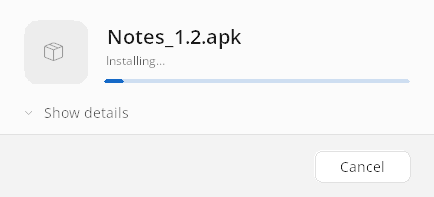
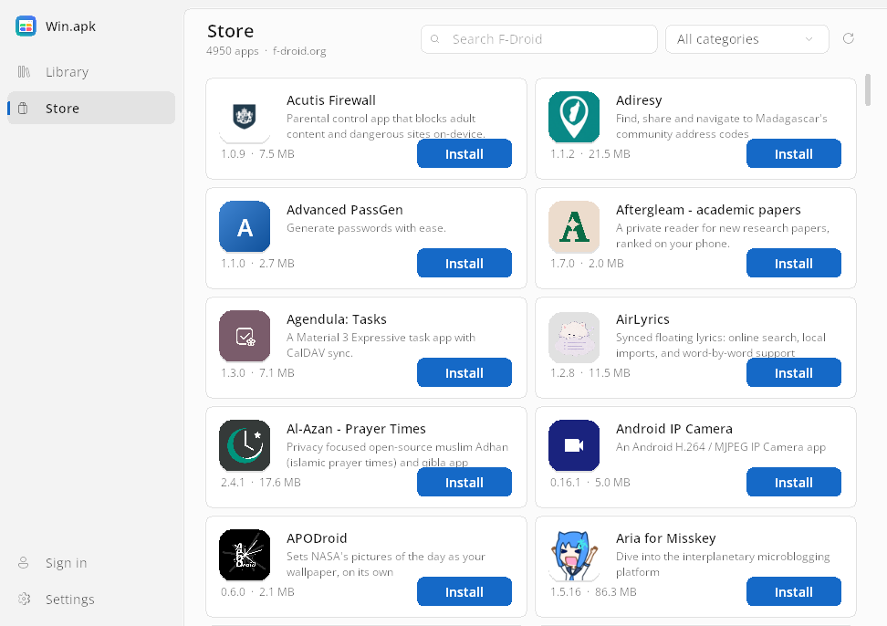
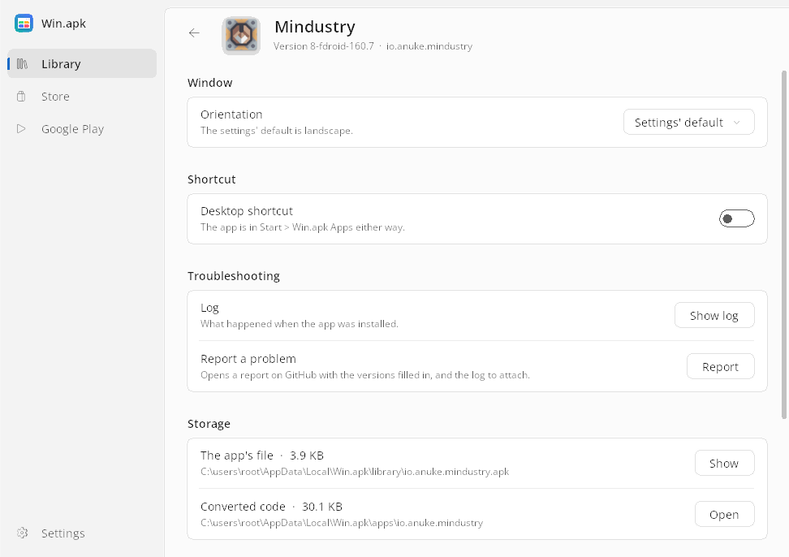
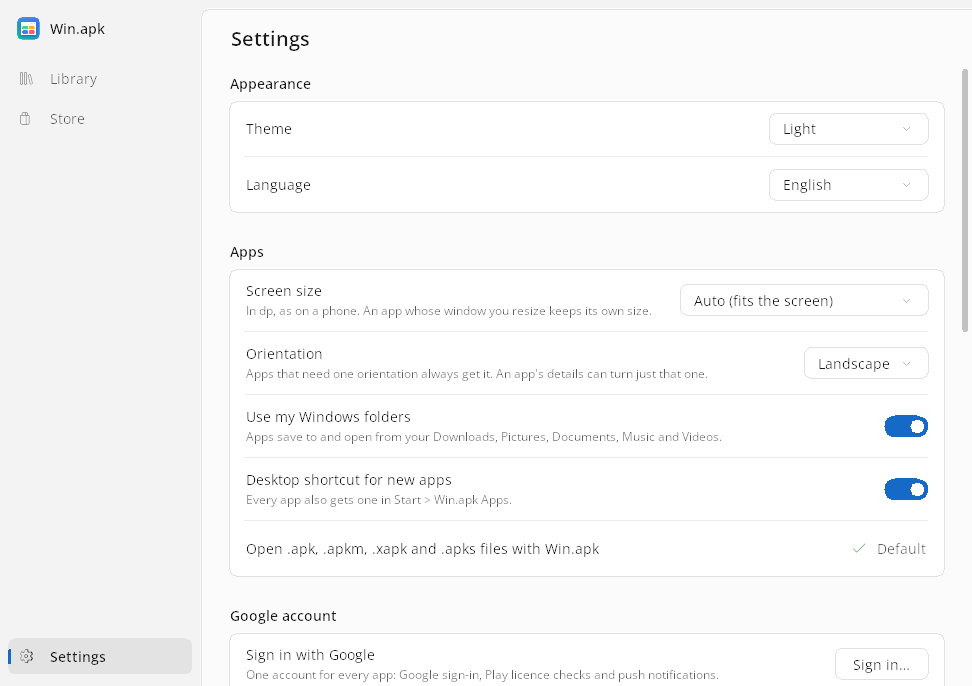
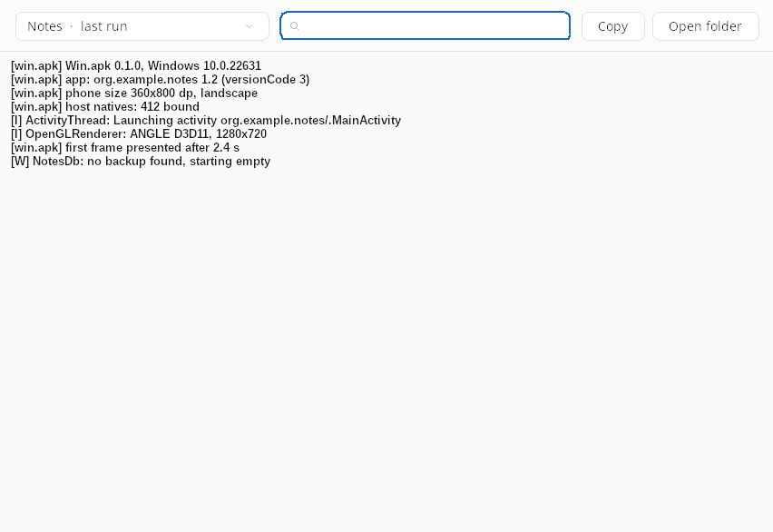

# Win.apk user guide

Every screen and setting of Win.apk, for reference. New to Win.apk? Start with
[Getting started](getting-started.md). What apps can and cannot do is on one
page, [Compatibility](APPS.md); problems and bug reports are in
[Troubleshooting](troubleshooting.md).

- [Installing apps](#installing-apps)
- [The Store](#the-store)
- [Running an app](#running-an-app)
- [Managing an app](#managing-an-app)
- [Settings](#settings)
- [Orientation and window size](#orientation-and-window-size)
- [Hebrew and right-to-left](#hebrew-and-right-to-left)
- [Shortcuts and file types](#shortcuts-and-file-types)
- [Permissions](#permissions)
- [Notifications](#notifications)
- [Google account](#google-account)
- [Updates](#updates)
- [Wi-Fi and Bluetooth](#wi-fi-and-bluetooth)
- [Shared storage](#shared-storage)
- [Logs](#logs)
- [Removing apps and uninstalling](#removing-apps-and-uninstalling)
- [Where things are](#where-things-are)
- [Command line](#command-line)
- [Troubleshooting](troubleshooting.md) (its own page)

## Installing apps

Win.apk installs four formats:

| File | What it is |
|---|---|
| `.apk` | A plain Android package |
| `.apkm` | A split-APK bundle from APKMirror |
| `.xapk` | A split-APK bundle from APKPure |
| `.apks` | A split-APK bundle made with bundletool |

A bundle holds a base APK and split APKs (languages, screen densities, CPU
architectures). Win.apk picks the splits the app needs here, the way the
Android installer does.

Any of these starts an install:

- double-click an app file in Explorer (see [Shortcuts and file types](#shortcuts-and-file-types)).
  Only the install window opens, not the library;
- drag one or more files onto the library window;
- click **Install app** in the library's toolbar (or press Ctrl+O) and choose files;
- click **Install** on an app's card in the [Store](#the-store);
- run `Win.apk.exe <file>` from a command line, which is the same as
  double-clicking it.

What happens during an install:

1. Win.apk copies the file into its library
   (`%LOCALAPPDATA%\Win.apk\library`), so you can delete the download.
2. The runtime unpacks the app the way an Android device does, converts its
   DEX code to Java classes, and extracts its icon and name. This takes up to
   a minute for a typical app, longer for very large ones, and happens once
   per app version.
3. If the app has only ARM64 native libraries, their translation to x64
   starts in the background (see [ARM apps](arm-apps.md)).
4. The app gets a tile in the library, a Start menu shortcut under
   **Start > Win.apk Apps** and, unless turned off in the settings, a desktop
   shortcut.

Installs run one at a time, in a small install window:



- While it works, the window shows the app's icon and name (the file's name
  until the app's own is read, near the end), a moving bar and one line on
  what it is doing: **Installing…**, then **Converting the app's code. This
  happens once.**, then **Getting the app's name and icon…**.
- **Show details** opens the install's log as it is written; each install
  window starts with it closed.
- Files opened while an install is under way, from Explorer or by dragging,
  join the same window: the one being installed is at the top, the others
  below it with their state.
- **Cancel** (or closing the window) stops the install after asking. What was
  not installed yet is left out; an app that was being updated keeps its
  previous version.
- When it is done: **Open** starts the app, **Close** closes the window, and
  **Show in library** opens the library with the app selected. With several
  apps each one has its own **Open**.
- When it fails: one sentence on why, **Report a problem** under it (see
  [Reporting a problem](troubleshooting.md#reporting-a-problem)), **Show log** (the install
  log, in the window) and **Copy details** (the reason, Win.apk's version and
  the end of the log, for a bug report).

Two apps with the same library name (the app's label) cannot coexist: a
second install of the same app replaces the first and keeps the app's data.
To update an app, open or drop a newer file of it: there is no separate
update button.

### Native code and CPU architectures

Android phones use ARM processors; a PC uses x86-64. An app's native code
(`lib/<abi>/*.so` inside the APK) falls into one of these cases:

| The APK has | What Win.apk does |
|---|---|
| No native libraries (Java or Kotlin only) | Runs directly |
| `lib/x86_64` | Loads those libraries directly, at full speed. Win.apk prefers this build whenever the APK or bundle has it |
| Only `lib/arm64-v8a` | Translates the libraries to x64 in the background; the app runs on an ARM64 JIT until the translation is ready |
| Only `lib/armeabi-v7a` (32-bit ARM) | Not supported. The app installs but stops when it loads that code; look for an x86_64 or arm64-v8a build |

#### ARM-only apps

An app with only 64-bit ARM libraries starts at once on an ARM64 JIT while
its code is translated for your processor in the background, at the lowest
priority. [ARM apps](arm-apps.md) explains which build of an app to install,
how the translation works, what it does when an app crashes, and the
settings and variables that control it.

## The Store



The **Store** tab is [F-Droid](https://f-droid.org)'s catalog of free and
open-source apps, usually Java-only and a good place to start. It lists the
apps that can run here: those without native code, with an x86_64 build, or
with an arm64-v8a build (translated). Where F-Droid offers one build per CPU
architecture, the x86_64 one is used. Type to search, or pick a category.

- **Install** downloads the APK from f-droid.org, checks it against the
  SHA-256 hash in F-Droid's index (a file that does not match is not
  installed) and installs it like a dropped file. The card shows the download
  and the install; then it says **Installed**, and the app opens from the
  library.
- **Update** appears when F-Droid has a newer version (by version code) of an
  app you have with the same package name, however you installed it. The
  app's data stays.
- Click a card for the app's details page: whether it is in your library, its
  version, size, license and categories, and a link to its F-Droid page.
  **Back** (the arrow, Esc or Alt+Left) returns to the Store.

The first time, the Store downloads F-Droid's index (tens of megabytes) and
keeps a summary of it in `%LOCALAPPDATA%\Win.apk\store\catalog.tsv`. After
that it opens at once and checks for a newer index in the background when
the saved one is more than six hours old; **F5** or the refresh button
checks now.

The Store needs an internet connection and reaches only f-droid.org. The
downloaded APK is deleted after the install.

## Running an app

Open an app by double-clicking its tile (or selecting it and pressing Enter),
from its right-click menu, or with its Start menu or desktop shortcut.

A launch window with the app's icon shows at once and stays until the app's
own window is up, the way a phone shows a splash screen. A start that takes
long says why: **Converting the app's code. This happens once.** when the
app's code changed, or **Still starting** after twenty seconds. Esc or the
✕ in its corner cancels the start. If the app ends before its window is up,
or later with an error, the same window turns into a short message
(**Wiz didn't start**, **Wiz stopped with an error**) with **Report a
problem** under it, and **Close** and **Show log**; Esc or Enter closes it.

Starts get quicker after the first app start of each Win.apk version: in
the background, Win.apk keeps the Java classes every app loads (the JDK's and
the Android framework's) ready in a file it maps at the next starts, instead
of reading and checking them again each time (class-data sharing): a fifth
off a typical start, and about 30 MB less memory per running app. Making that
file takes a few seconds of one core at low priority, once, and about 40 MB in
`%LOCALAPPDATA%\Win.apk\cds`.

The library marks a running app with a green badge on its tile and counts
them under its title. **Stop** in the tile's right-click menu, or on the
app's details page, closes the app at once.

In an app:

| You do | The app sees |
|---|---|
| Click, drag | A finger touch and drag |
| Mouse wheel | A short scroll gesture |
| Keyboard | Key presses, including typing into text fields |
| **Escape**, **Alt+Left**, the mouse's back button | Android's Back |
| Close the window | The app quits |
| Resize, maximize or snap the window | A display of the new size; the app lays itself out again |

What an app can use (sound, video, the camera, Bluetooth and the rest) is
listed in [Compatibility](APPS.md#what-works).

An app runs once at a time. Starting it again (from a shortcut or the
library) brings the running window to the front.

Closing the library while an app it started is still running, or while an
install is under way, only hides it: Win.apk stays until those finish, so it
can still report an app that stops with an error.

Apps run with your Windows user account's permissions. There is no
phone-style sandbox: install only apps you trust ([`SECURITY.md`](../SECURITY.md)).

### Library keyboard shortcuts

| Keys | Action |
|---|---|
| Arrow keys, Home, End, Page Up/Down | Move between apps |
| Enter | Open the selected app |
| Alt+Enter | The selected app's details |
| Menu key, Shift+F10 | The selected app's right-click menu |
| Typing, Ctrl+F | In the Store: search it; Esc shows everything again |
| Ctrl+O | Add an app from a file |
| Ctrl+1, Ctrl+2 | The Library and the Store |
| Ctrl+, | Settings |
| Ctrl+L | The log window, on the newest log |
| F5 | In the Store: check F-Droid for new apps |
| Esc, Backspace, Alt+Left, the mouse's back button | On a details page: back |
| Tab, Space, Enter | On a page: move between its controls and use them |

## Managing an app

Right-click an app's tile for its menu: the app's icon, name and version at
the top, then **Open**, **Stop** (while it runs), **App details** and
**Remove**, each with its icon and shortcut. It follows the theme and, in
Hebrew, opens to the left.

Win.apk asks its questions in dialogs of its own, in the same look as the
library, light or dark and mirrored in Hebrew: **Remove**, **Clear library**,
**Stop installing?**, signing out of Google, an error with **Show log**, an
app asking to install, update or remove another app, and the permission
questions apps ask. The accent button comes first; for anything that removes
something, Enter picks **Cancel**. Esc or the window's ✕ closes a dialog
without an answer.

**App details** (also Alt+Enter) is a page in the library, with a back arrow:



| Section | What it holds |
|---|---|
| Window | **Orientation**: the settings' default, portrait or landscape for this app only (an app whose manifest fixes one shows **Portrait – required by the app** or **Landscape – required by the app** instead). **Window size**: the size the app's window was last given, with **Reset** |
| Permissions | A switch per permission the app was asked for or granted, and **Reset permissions**; see [Permissions](#permissions) |
| Shortcut | **Desktop shortcut**: adds or removes the app's desktop shortcut. The Start menu one is always there |
| Performance | Only for an app with only ARM code: **Optimizing for this PC…** while its translation runs in the background (with the parts done so far), and **This app has only ARM code** when a library is too large to translate whole, so an x86_64 build of the app, if one exists, runs faster. See [ARM apps](arm-apps.md) |
| Troubleshooting | **Log** (View the app's recent logs): **Show log** opens the log window on the app's last run (or its install, before the first run). **Report a problem** (opens a GitHub issue with the app's details and log): for a problem met inside the app; see [Reporting a problem](troubleshooting.md#reporting-a-problem) |
| Storage | **The app's file**: its size, and **Show** opens Explorer on it. **Run files**: what Win.apk prepared to run the app, its folder under `apps\`, and **Open** |
| Manage | **Stop** (while it runs) and **Remove** |

Each action has one place: the details page, plus the right-click menu for
the four above. An app's log is on its details page (**Troubleshooting >
Show log**); Ctrl+L opens the log window on the newest log.

## Settings

**Settings**, at the bottom of the navigation pane (or Ctrl+,), is a page of
its own. Each setting takes effect the next time an app opens unless noted.



| Section | Setting | What it does |
|---|---|---|
| Appearance | **Theme** | Follow Windows (the default), Light or Dark. Applies at once |
| Appearance | **Language** | Follow Windows (the default), Hebrew (עברית) or English. Applies at once; see [Hebrew and right-to-left](#hebrew-and-right-to-left) |
| Apps | **App window size** | The size apps open at, in dp (density-independent pixels, as on a phone). **Auto** is 360 × 800 dp, or the size given by `WINAPK_PHONE_SIZE` when that variable is set. Presets range from 320 × 480 to a 10-inch tablet. An app whose window you resized opens at its saved size |
| Apps | **Default orientation** | Portrait or landscape, for every app that has no choice of its own. The default is landscape, the shape of a PC screen. Apps that require an orientation always open in it; an app's details page changes it for that app |
| Apps | **Use my Windows folders** | On: apps' shared storage (Downloads, Pictures, Documents, Music, Movies) is your own Windows folders. Off: each is an empty folder of Win.apk's own, and your files stay where they are. See [Shared storage](#shared-storage) |
| Apps | **Speed up ARM apps** (on) | Translates ARM code to your PC's code in the background, at low priority, so apps run faster. Off: no translation is started, one under way stops before its next part (and goes on where it was once this is on again), and translations already made are still used. See [ARM apps](arm-apps.md) |
| Apps | **Desktop shortcut for new apps** | Every app gets a Start menu shortcut; this adds one on the desktop too |
| Apps | **Open .apk, .apkm, .xapk and .apks files with Win.apk** | Makes Win.apk the default program for the four formats |
| Google account | **Sign in**, **Add another account**, **Sign out**; **Use Google services (experimental)** (off), and with it on **Google services setup** | See [Google account and Google services](google-services.md) |
| Troubleshooting | **Logs** | Opens the `logs` folder in Explorer, to attach files to a bug report |
| Troubleshooting | **App data** | Opens `%LOCALAPPDATA%\Win.apk` |
| Troubleshooting | **Clear library** | Uninstalls every app of the library and removes its shortcuts (app data is kept; Google's apps stay with Google services) |
| Updates | **Check** | Asks GitHub for the newest release at once. The row shows this copy's version and the last check's result: up to date, a newer version, or could not check. See [Updates](#updates) |
| Updates | **Check for updates automatically** | On (the default): about once a day, while the library is open, Win.apk checks for a newer release in the background and says so in the InfoBar |
| Updates | **Update** | Shown when a newer version is out, with **What's new in** that version below it. Downloads the installer, then runs it and closes Win.apk |
| About | | The version, **Project page** (github.com/israel2176/win.apk) and **Credits and licenses**, which opens `THIRD_PARTY_NOTICES.txt` beside the program (Mac.apk, which Win.apk is built on, and every project the package ships, with their licences; `LICENSE.txt` is Win.apk's own, the GNU AGPL v3.0) |

Settings are stored under `HKEY_CURRENT_USER\Software\Win.apk`.

## Orientation and window size

An app opens in the orientation decided by these rules, first match wins:

1. The orientation the app's manifest fixes for its first activity (a
   portrait-only game always opens portrait).
2. The app's own choice on its details page (**Window > Orientation**).
3. The **Default orientation** setting (landscape by default).

The **App window size** setting gives the phone's dimensions in dp; the
orientation decides which is the width. The app's window opens at that size,
scaled for your monitor. If the window would not fit the monitor's work area,
the app keeps its dp size and is drawn smaller.

The window is the app's display. Dragging an edge, maximizing or snapping
gives the app a display of the new size, and it lays itself out again, as an
Android desktop window does. An app that fixed its orientation keeps its
shape in a window of the other one: it is drawn in the largest box of its
aspect, centred, with black bars around it.

The size you settle on is remembered per app and used the next time the app
opens, before the App window size setting. The app's details page shows it and
can reset it; choosing another orientation for the app also forgets it.

## Hebrew and right-to-left

Win.apk speaks English and Hebrew. When the Windows display language is
Hebrew, the installer and the library open in Hebrew; otherwise pick
**Language > עברית** in the settings, and the library switches at once. In
Hebrew every window of Win.apk is laid out right to left: the library, its
pages, the install window, the launch window, the permission questions, menus
and dialogs. So is the installer, title bar included (its icon on the right,
Close on the left, Finish at the bottom left). Logs stay left to right.

An app's window follows Windows' reading layout for right-to-left users: its
title bar is mirrored, while the app draws its own layout as it would on a
phone.

## Shortcuts and file types

- Every installed app gets a shortcut in **Start > Win.apk Apps** with its
  own icon. The shortcut starts the app through Win.apk, with the launch
  window.
- A desktop shortcut is added too when **Desktop shortcut for new apps** is
  on; an app's details page adds or removes it later.
- The installer makes `.apk` files open with Win.apk. The setting
  **Open .apk, .apkm, .xapk and .apks files with Win.apk** extends that to the
  other three, and takes the `.apk` association back if another program took
  it. Double-clicking such a file opens the install window.
- When Win.apk is updated, it writes every app's Start menu and desktop
  shortcuts again once, so they carry what the new version needs.

## Permissions

Apps ask for permissions as on Android. When an app requests a dangerous
permission group, a small window opens over the app with its icon and name,
one question ("Allow Wiz to access this PC's location?"), at most a line on
what it means on a PC, and two buttons:

- **Allow** grants the group. **Don't allow** denies it; a second refusal
  denies it for good and the app is not asked again. Enter means Don't allow,
  so a stray key never grants anything; Esc or closing the window answers
  nothing.
- Location has a **Precise location** switch: off, Allow grants only the
  approximate location. An app that wants location in the background is
  asked for that separately once the foreground permission is granted.
- A permission in a group that already has a granted member is granted
  without asking, as Android does.
- Apps built for Android 5 and older hold what they declare, as on a device.

The groups: storage and media (photos and videos, music and audio, files),
location, camera, microphone, contacts, calendar, phone, call logs, SMS,
notifications, nearby devices, physical activity and body sensors.

The special access a device grants in its Settings app has the same window
here: **All files access**, **Media management**, **Display over other apps**
and **Install unknown apps**. For access Windows cannot provide (notification
access, accessibility services, usage access, Do Not Disturb access), the
dialog says so and grants nothing. For what Win.apk never restricts (battery
optimization, exact alarms, modifying system settings), it says the app
already has it.

Your answers are kept per app, signed, in `%LOCALAPPDATA%\Win.apk\appops`,
and survive restarts and updates. Removing the app forgets them. To change a
permission later, use the app's own **App info** screen (an app that opens
its settings page lands there: a switch per permission, then **Done**) or
**Permissions** on the app's details page in the library, where **Reset
permissions** forgets them all. Turning a permission off stops the app if it
is running, as Android does.

Granting a permission does not create the data behind it: a PC has no
contacts, SIM, SMS or sensors, so an app that is granted those finds them
empty. The camera and microphone use the PC's webcam and microphone, behind
Windows' own privacy switches (Settings > Privacy). Location comes from
Windows' location service; when Windows denies it, Win.apk opens the Windows
location settings page once per run.

## Notifications

An app's notifications appear as Windows notifications, with the app's name
and icon, and stay in the Action Center until dismissed. Notifications on a
low-importance channel go to the Action Center without popping up. Clicking
one brings the app forward and opens what a tap would open on Android, as
long as the app is running. Apps made for Android 13 or later ask for the
notification permission first; Windows' own notification settings apply on
top of that. Action buttons on notifications are not shown.

## Google account

**Settings > Google account** signs in with Google (on Google's own page, in a
window of its own: Win.apk never sees the password), adds another account and
signs out. A sign-in that fails says so with the error's code (a WebView2,
network or HTTP code, or Google's own, such as `UNREGISTERED_ON_API_CONSOLE`).

An app that signs in through the browser (for example a game's account login)
and expects the answer at one of its own verified web addresses (Android App
Links) or its own link scheme gets its sign-in page in a Win.apk window instead
of Edge or Chrome, which would only open that address as a web page. When the
page finishes, the window closes and the app gets the answer, as from a
phone's browser. Closing the window, or leaving it for 10 minutes, cancels the
sign-in. One account serves every app, and the account's item at the foot
of the navigation pane, above **Settings**, shows who is signed in (only the
account's picture, or its initial when Google gave none, or the person icon when
no one is; the address shows when you point at it) and opens Settings. **Use Google
services (experimental)** runs Google's own Play services and Play Store,
which you install through the **Google services setup** page; with it on,
**Google Play** appears under **Store** in the navigation pane and opens the
Play Store inside the Win.apk window, where the library is. Google's three
apps are system components: they have no tile in the library and no
shortcut.

[Google account and Google services](google-services.md) explains both, the
setup step by step, and what does not work.

## Updates

Win.apk's releases are published on GitHub
([github.com/israel2176/win.apk/releases](https://github.com/israel2176/win.apk/releases)).
**Settings > Updates** shows the version you have and what the last check
found; **Check** checks at once. With **Check for updates automatically**
on (the default), the library checks about once a day when it opens and every
hour while it stays open, once a day has passed since the last check. The
check downloads only GitHub's list of releases and sends nothing about you or
your apps (the request names itself `Win.apk-updater`). Versions are compared
by their numbers: `v0.3.0-preview` is newer than 0.2.0.

When a newer version is out, the InfoBar says so with **What's new**, which
opens Settings at Updates: the new version's row with **Update**, and its
release notes as plain text under **What's new in** that version, with a link
to its page on GitHub. **Update** downloads `Win.apk-Setup.exe` from the
release (the button shows how far it is), checks that it is complete (its
size, and its SHA-256 when GitHub gives one), runs it and closes Win.apk so
that the installer can replace it. Your apps and their data are kept. The
update does not start while an app is running or an install is under way:
close the app or wait, then press **Update** again. A downloaded installer is
kept in `%LOCALAPPDATA%\Win.apk\updates` until the update has been installed.

## Wi-Fi and Bluetooth

Apps see the PC's Wi-Fi and the Bluetooth devices paired in Windows Settings.
Network names and scan results need location access for desktop apps in
Windows' privacy settings, as Android needs the location permission. What
exactly works is in [Compatibility](APPS.md#the-pcs-hardware).

## Shared storage

On a phone, apps share folders such as Download and Pictures. Here those
folders are your own Windows folders: `/sdcard/Download`, `Pictures`,
`Documents`, `Music` and `Movies` are links to Windows' Downloads, Pictures,
Documents, Music and Videos, made before an app starts. Anything an app had
saved there earlier is moved into your folders first, never over a file of
yours (a name clash comes in as `name (from Android).ext`). `DCIM` stays
Win.apk's own.

**Settings > Apps > Use my Windows folders** turns this off: each folder
becomes an empty one of Win.apk's own again, and your files stay where they
are.

## Logs

The log window (an app's details page, **Troubleshooting > Show log**, or Ctrl+L) shows
any of Win.apk's logs and follows the end as it is written. Pick the log at
the top left ("Wiz · last run", "Wiz · install", "Google sign-in"…), search
it (every match is marked; Enter or F3 goes to the next, Shift+F3 back),
**Copy** it to the clipboard, or **Open folder** to see the file in Explorer
(`%LOCALAPPDATA%\Win.apk\logs`). Error lines are in red. The install window
and the launch window open the right log themselves when something fails.



| File | What it records |
|---|---|
| `run-<app>.log` | That app's last run; `run-<app>.1.log` is the run before it |
| `last-run.log` | The app opened most recently (a second name for its `run-<app>.log`) |
| `install-<app>.log` | That app's install or update |
| `gms.log` | The Google account operations run from the settings |
| `google-setup.log` | The checks of the Google services setup |
| `system.log`, `services\` | With Google services on: the system broker, and the apps it starts for other apps |
| `install-helper.log`, `package-backfill.log` | Installs an app itself asked for (F-Droid installing another app: Win.apk asks first; the Play Store Google signed: no question, as on a phone), and library maintenance |
| `hs_err_pid<n>.log` | A crash report from the Java VM, if the VM itself crashed |
| `crash-<app>-<date>.dmp` | A minidump of the app's process when its native code crashed (the last three per app); attach it to an issue with the log |

## Removing apps and uninstalling

- **Remove** (on the app's details page or its right-click menu) asks first
  (**Remove** *app*: "Removes the app and its shortcuts."), then deletes the
  app's APK, run files, icon and shortcuts, and forgets
  its permissions. What the app saved stays, so installing it again picks up
  where it left off, unless you tick **Also remove accounts and data saved by the app**:
  then its data folder (`android\data\data\<package>`) and its folders in
  shared storage (`Android\data` and `Android\obb`) go too, as uninstalling
  does on a phone. Your own files in your Windows folders are never touched.
- **Settings > Troubleshooting > Clear library** uninstalls every app of the
  library and removes its shortcuts (app data is kept).
- Uninstalling Win.apk (Windows Settings > Apps) removes the program, the
  Start menu shortcuts and the `.apk` association, and keeps
  `%LOCALAPPDATA%\Win.apk`. Delete that folder to remove the apps, their data,
  the Store's catalog and the Google account.

## Where things are

| What | Where |
|---|---|
| Win.apk itself | `%LOCALAPPDATA%\Programs\Win.apk`, or the folder you unzipped |
| Your copy of each APK | `%LOCALAPPDATA%\Win.apk\library\<app>.apk` |
| Per-app choices beside the APK | `<app>.label` (name), `<app>.package` (package, version, manifest orientation), `<app>.orientation` (your choice), `<app>.window` (remembered window size) |
| Each app's run files, icon and name | `%LOCALAPPDATA%\Win.apk\apps\<app>` (and `aot-guard.txt`, an ARM-only app's crashes with its translation) |
| The Android file system: apps' data, the installed packages | `%LOCALAPPDATA%\Win.apk\android` |
| Logs | `%LOCALAPPDATA%\Win.apk\logs` |
| The Store's catalog and icons | `%LOCALAPPDATA%\Win.apk\store` |
| The installed-apps registry | `%LOCALAPPDATA%\Win.apk\installed_apps.json` |
| Permission grants | `%LOCALAPPDATA%\Win.apk\appops` |
| The Google account and its tokens | `%LOCALAPPDATA%\Win.apk\gms` |
| The last update check and a downloaded update | `%LOCALAPPDATA%\Win.apk\updates` (`releases.json`, `Win.apk-Setup-<version>.exe`) |
| Shared ARM translations | `%LOCALAPPDATA%\Win.apk\aot-cache` |
| The runtime's caches (fonts, resources) | `%LOCALAPPDATA%\Win.apk\cache` |
| The Java classes every app shares, ready to map (class-data sharing) | `%LOCALAPPDATA%\Win.apk\cds` (`framework-<key>.jsa`; delete the folder to have it made again) |
| Settings | `HKEY_CURRENT_USER\Software\Win.apk` (`Theme`, `Language`, `PhoneSize`, `Landscape`, `DesktopShortcut`, `UserFolders`, `AotBackground`, `AutoUpdate`, `LastUpdateCheck`, `GoogleServices`, and the library window's size) |
| With Google services on: app uids, the account service, the installer of record, the broker's readiness | `%LOCALAPPDATA%\Win.apk` (`app_uids.properties`, `system_ce\`, `installer-of-record.properties`, `run\`) |
| Start menu shortcuts | `Start > Win.apk Apps` |

`<app>` is the app's package name (`com.waze`) when the file it came from
is named after it, as APK download sites name them, else the file's name up
to its version (`WhatsApp_2.24.1.apk` gives `WhatsApp`). Apps installed
before this keep their folders.

## Command line

```bat
Win.apk.exe                          :: the library
Win.apk.exe app.apk [more files]     :: the install window only, for these files
Win.apk.exe --run <library apk>      :: open an installed app, with its launch window (what its shortcuts do)
```

One Win.apk serves everything: a second start hands its files, or its wish
to see the library, to the one already running, so files opened together
share one install window.

The runtime can also be run directly, for testing:

```bat
bin\winapk-runtime.exe --apk <file.apk|.apkm|.xapk|.apks> [--data <dir>] [--jdk <dir>] [--lib <dir>] [--install-only]
bin\winapk-runtime.exe [--data <dir>] [--jdk <dir>] [--lib <dir>] --gms <command> [args]
bin\winapk-runtime.exe [--data <dir>] [--jdk <dir>] [--lib <dir>] --verify-apk <file>
```

| Option | Meaning |
|---|---|
| `--apk` | The app to install and run |
| `--data` | The data folder (default `%LOCALAPPDATA%\Win.apk`) |
| `--jdk` | The Java runtime (default: the `jre` folder next to `bin`, else `WINAPK_JAVA_HOME` or `JAVA_HOME`) |
| `--lib` | The folder with the framework jars (default: `lib` next to `bin`) |
| `--install-only` | Install and convert the app, write its icon and name, and exit |
| `--gms <command>` | Run a Google Play services command with no app: `status`, `selftest`, `accounts`, `signin-window`, `signin-master` (an account from its e-mail and master token on standard input, for tests), `signout`, `checkin`, `license <package> <versionCode>`, `gcmtoken <package>` and the rest of `com.macapk.gms.GmsCli` |
| `--verify-apk <file>` | Print an app file's package and whether its signature verifies and Google signed it (`PACKAGE`, `VERIFIED`, `REASON`, `SCHEME`, `LINEAGE`, `GOOGLE` lines), as the Google services setup asks |

Exit codes: 0 done, 2 wrong arguments, 3 when `--install-only` finds the app
running. `--gms` exits 0 done, 1 error (an `ERROR` line on standard output),
2 cancelled or wrong arguments. `--verify-apk` exits 0 signed by Google, 4
signed by another key, 3 the signature does not verify, 1 not an app.

Environment variables the launcher and the runtime read:

| Variable | Effect |
|---|---|
| `WINAPK_PHONE_SIZE=412x915` | The phone size in dp. The launcher sets it from the App window size setting; set it yourself for the **Auto** preset or a direct run |
| `WINAPK_RESIZABLE=0` | The window letterboxes the phone instead of resizing the app |
| `WINAPK_DENSITY=<dpi>` | Overrides the density the app sees |
| `WINAPK_AOT_CLANG=<path to clang.exe>` | The compiler for ARM translation |
| `WINAPK_AOT=0` | Run ARM-only apps' code on the JIT only: no translation is loaded or made |
| `WINAPK_ABIS=arm64-v8a` | Install an app's ARM64 build although it has an x86_64 one (for comparing the two) |
| `WINAPK_ALLOW_SECOND_INSTANCE=1` | Allow a second copy of a running app |
| `WINAPK_WEBVIEW2=0` | Do not use WebView2; web links open in the system browser |
| `WINAPK_ANGLE_BACKEND=d3d11` or `swiftshader` | Force a graphics backend |
| `WINAPK_PROXY=socks5://host:port` | A SOCKS proxy for the push (Firebase Cloud Messaging) connection |
| `WINAPK_CDS=0` | Start the Java runtime without class-data sharing, as Win.apk 0.8 did (slower; for comparing, or if a start fails with `[cds]` lines in its log) |
| `WINAPK_HEADLESS=1` | Run without a window, for tests |
| `WINAPK_HEADLESS_FRAME=frame.bmp` | Save the last frame the app drew |
| `WINAPK_HEADLESS_EXIT_AFTER_FRAMES=30` | Exit that many frames after the first |

[`windows/README.md`](../windows/README.md) lists the variables meant for
development and testing.

## Troubleshooting

Common problems, what the lines of a log mean, and how to report a problem
are on their own page: [Troubleshooting](troubleshooting.md).
