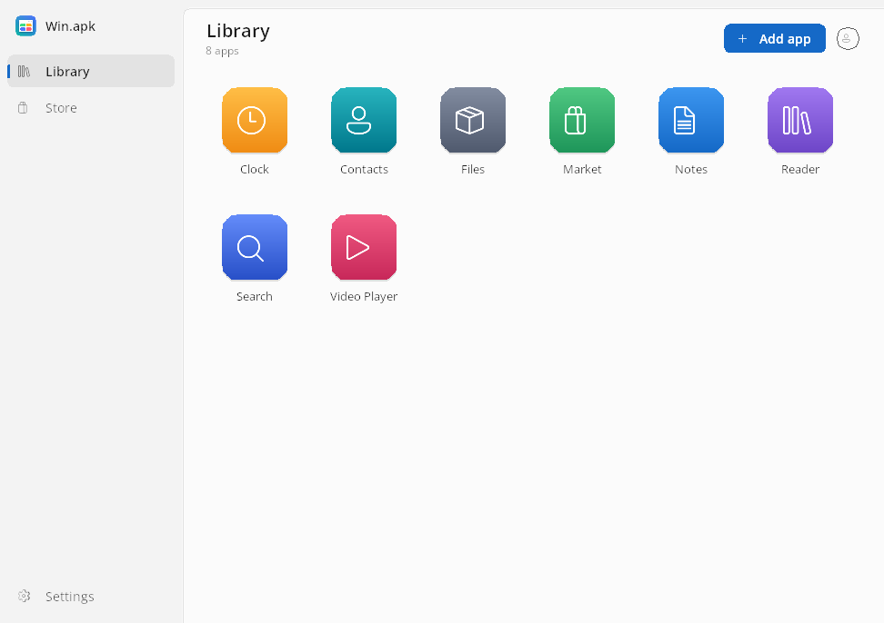
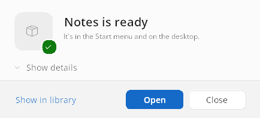

# Getting started

**🇮🇱 [לדף הזה בעברית — לחצו כאן](he/getting-started.md)**

From download to your first Android app on Windows, in about five minutes.

- [What you need](#what-you-need)
- [Install Win.apk](#install-winapk)
- [Add your first app](#add-your-first-app)
- [Use an app](#use-an-app)
- [Updating and uninstalling](#updating-and-uninstalling)

## What you need

| | |
|---|---|
| **Windows** | Windows 10 (version 1903 or later) or Windows 11, 64-bit (x64). Windows on ARM has not been tried |
| **Graphics** | A GPU with Direct3D 11. Without one, a software renderer takes over, more slowly |
| **WebView2 Runtime** | For web pages inside apps and for Google sign-in. Windows 11 and most Windows 10 PCs already have it |
| **Disk** | About 500 MB for Win.apk (it includes Java, the graphics layer and a compiler), plus the apps you install |
| **Administrator rights** | Not needed. Win.apk installs for your user only |

There is no virtual machine, so nothing needs to be turned on in the BIOS or in
Windows Features.

## Install Win.apk

1. Open the [latest release](https://github.com/israel2176/win.apk/releases/latest)
   and download one of:
   - **`Win.apk-Setup.exe`**, the installer (recommended): installs into
     `%LOCALAPPDATA%\Programs\Win.apk`, adds Win.apk to the Start menu and
     opens `.apk` files with it;
   - **`Win.apk-windows-x64.zip`**, the portable copy: unzip it anywhere and
     start `Win.apk.exe`.
2. Run the installer. **Windows SmartScreen will warn** that it does not know
   the publisher, because preview builds are not code-signed yet. Click
   **More info**, then **Run anyway**.
3. The installer speaks English or Hebrew, following the Windows display
   language. So does Win.apk; Settings > Appearance > Language changes it.

## Add your first app

There are three ways to add an app:

- **From the Store.** Click **Store** in the left pane. It is the catalog of
  [F-Droid](https://f-droid.org), free and open-source apps, and the easiest
  place to start: it lists only apps that can run here and picks the right
  build for you. Search, then click **Install**.
- **From a file.** Double-click an `.apk`, `.apkm`, `.xapk` or `.apks` file in
  Explorer, drag it onto the library, or click **Add app**. Before you download
  an app elsewhere, read [which build to install](arm-apps.md#which-build-to-install).
- **From Google Play.** Possible, but experimental: see
  [Google services](google-services.md).

A small install window shows the progress. The first install of an app
converts its code, which takes up to a minute. When it is done, the app is in
the library, in **Start > Win.apk Apps** and, unless you turned it off, on the
desktop.

## Use an app

Double-click the app in the library, or use its Start menu shortcut. A launch
window with the app's icon shows until the app's window is up.

| You do | The app sees |
|---|---|
| Click, drag | A finger tap and swipe |
| Mouse wheel | A scroll |
| Type | The keyboard, as on a phone with a hardware keyboard |
| **Esc**, **Alt+Left** or the mouse's back button | Android's Back |
| Resize, maximize or snap the window | A bigger or smaller screen; the app lays itself out again |
| Close the window | The app quits |

Apps open in landscape, the shape of a PC screen, unless the app requires
portrait. Right-click an app in the library and choose **App details** to turn
it the other way, see its permissions, its log and its files.

When an app asks for a permission (the camera, your location, files), Win.apk
asks you in a small window over the app, as a phone would. Windows' own privacy
switches still apply.

## Updating and uninstalling

- **Win.apk** checks GitHub for a new release about once a day and says so in
  the library; **Update** downloads and runs the new installer and keeps your
  apps. Settings > Updates turns the check off.
- **An app** updates when you install a newer file of it, from its details page
  (**Update from a file**), or from the Store (**Update**).
- **Removing an app** (right-click > Remove) keeps what it saved unless you tick
  **Also delete what the app saved**.
- **Uninstalling Win.apk** (Windows Settings > Apps) keeps your apps and their
  data in `%LOCALAPPDATA%\Win.apk`. Delete that folder to remove everything.

Next: the [user guide](USER_GUIDE.md) covers every screen and setting, and the
[FAQ](faq.md) answers the common questions.
