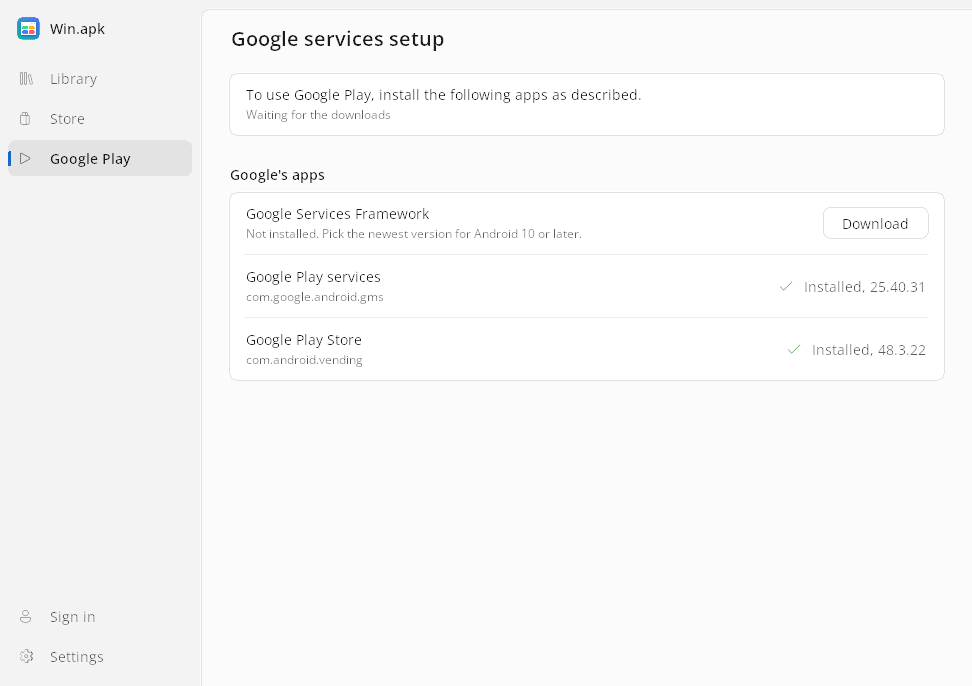

# Google account and Google services

**🇮🇱 [לדף הזה בעברית — לחצו כאן](he/google-services.md)**

Many Android apps use Google Play services: to sign in with Google, check
their Play licence, receive push messages or ask for the location. Win.apk
offers two levels of support.

| | Built in (default) | Google services (experimental) |
|---|---|---|
| What runs | Win.apk's own stand-ins, inside each app | Google's real Play services, Services Framework and Play Store, which you install |
| Sign in with Google | ✅ | ✅ |
| Play licence checks | ✅ | ✅ |
| Push messages (Firebase Cloud Messaging) | ✅ | ✅ from Google's Play services |
| Firebase Analytics, fused location | ✅ | ✅ |
| Apps that insist on Google's own Play services | ❌ | ⚠️ tried with a few apps |
| The Play Store | ❌ | ⚠️ signs in, installs and updates free apps, also in the background |
| In-app purchases, Play Integrity, the Maps SDK's map | ❌ | ❌ |

Start with the built-in level. Turn Google services on only for an app that
needs it.

## Signing in

**Settings > Google account > Sign in** opens Google's own sign-in page in a
window of its own (Microsoft Edge WebView2, private profile). Win.apk never
sees your password; it keeps the token Google hands back, only on this PC, in
`%LOCALAPPDATA%\Win.apk\gms`, encrypted for your Windows account (Windows'
data protection, DPAPI).

- **Apps never get the account's token.** As on a phone, where only Google
  Play services holds it, the token Google hands back at sign-in stays with
  Win.apk's own Google side (Settings, the sign-in window and a small
  background token service). An app that needs Google asks that service and
  gets a short-lived token for what it asked, minted for that app and no
  other. The service starts when an app first needs it and stops by itself
  after a few idle minutes; its log is `logs\gms-tokens.log`. A token saved
  by an older Win.apk is encrypted and moved the first time Win.apk's Google
  side opens it.

- **One account for every app.** An app's **Sign in with Google** opens the
  same window when no account is signed in yet; with an account, the app shows
  its chooser.
- The account's item at the foot of the left pane, above Settings, shows the
  signed-in account's picture and address and opens Settings at the Google
  account section.
- **Sign out** forgets the account and its tokens on this PC.
- Signing in works behind a filter or proxy whose certificate Windows trusts.
- It needs the WebView2 Runtime (2022 or later).
- When the sign-in fails, the message carries the error's code (for example
  `WEB_ERROR HOST_NAME_NOT_RESOLVED (13)`, `WEBVIEW2_RUNTIME_MISSING (0x80070002)`,
  `HTTP 403 Error=BadAuthentication`), and `logs\gms.log` has the details.
  An app's **Sign in with Google** that Google refuses says so with its code,
  for example `UNREGISTERED_ON_API_CONSOLE` for a copy of the app that is not
  signed by its developer.

### How the built-in stand-ins present themselves

- To apps, the built-in Play services and Play Store report Google's public
  signing certificate: the one every app's own Google library compares them
  with before it uses Play services at all. Only the certificate is shown; no
  Google key is used and nothing is signed with it.
- For a Play licence check, Win.apk asks Google for the licensing token in the
  Play Store's name (its package name and its public certificate fingerprint),
  because Google issues that token to no other client; microG and Aurora Store
  do the same. The answer the app gets is Google's own signed response for
  your account, and the app checks it itself: an app your account does not
  own is told so.
- Neither is a device certification: Play Integrity and SafetyNet are not
  answered, and the device is not Play Protect certified (below).

## Google services (experimental)

**Settings > Google account > Use Google services (experimental)** (off by
default) runs Google's real Play services, Services Framework and Play Store
as apps, once you have installed them yourself. Win.apk never ships or
downloads Google's apps.

### Setting it up

1. Turn on **Use Google services (experimental)**. The **Google services setup** page opens
   by itself (later: **Google Play** in the left pane, or the row under the
   switch).
2. For each of the three apps, Google Services Framework, Google Play services
   and Google Play Store, click **Download**. It opens the app's APKMirror page
   in your browser. Pick the variant the row names (x86_64 or nodpi, for
   Android 10 or later) and use APKMirror's own download button.
3. Keep the page open. Win.apk watches your Downloads folder (or take a file
   you drop on the page), checks it and installs it. A file is refused, with
   the reason, when **Google did not sign it**, when it has native code but
   none for x86_64 (download the x86_64 variant), or when it needs a newer
   Android (API level) than Win.apk presents (download an older version).
4. When all three are ticked, **Google Play** in the left pane opens the Play
   Store inside the Win.apk window, where the library is, not in a window of
   its own. Switching to another tab keeps it running; **Google Play** shows
   it again. Closing the Win.apk window closes it.

The three apps are part of Google services, not apps of your library: they
have no tile, menu or shortcut, and their versions show only on the setup
page.

The first time, Play services needs about a minute to check in with Google; a
Play Store opened before that may show "Server error" (press **Try again**).
From then on the Play Store keeps itself and Play services up to date.

### The Google account with Google services on

There is still one Google account, Win.apk's. The Play Store's **Sign in**
(and any app that asks Android to add a Google account) opens the same
sign-in window as **Settings > Google account > Sign in**, and the account
added there is the one Settings shows. Play services and the Play Store then
see it as a device's Google account, with the token Google gave at sign-in.
A sign-in or sign-out in Settings reaches Play services and the Play Store
while they run, within a second or two; signing out there signs them out too.

(On a phone, Play services shows its own sign-in pages. Win.apk cannot run
them: they need a device check Win.apk does not fake, and they open in
another app's window, which an app on Win.apk cannot do with the answer the
sign-in needs. So the window is Win.apk's own, on Google's own page.)

### What was tried

With Google's own APKs: push-message tokens for Telegram, Moovit and the Play
Store; the Play Store signed in with the account; installing an app from it
(Google's Calculator: download, the app in the library
with the Play Store as its installer, and the app opens); the Play Store
updating its own helper apps. The Play Store installs and updates without
Win.apk asking again, as a phone's does: only the copy Google signed, checked
each time. Any other app that installs one gets the question. Most apps have not been tried yet: please
[report](troubleshooting.md#reporting-a-problem) what you find.

### App updates from the Play Store

As on a phone, the Play Store keeps your apps up to date, including apps you
installed from a file: it updates an app that has an update in Play, unless
you turned **Auto-update apps** off in the Play Store's own settings (its
**Over Wi-Fi only** choice waits for a network Windows does not count as
metered). An app that refuses to run until it is updated (some banking apps)
can also be updated from its page in the Play Store, or with **Update all**
under **Manage apps & device**.

- **In the background.** The Play Store checks for updates with background
  jobs, which Win.apk keeps when the Play Store is closed and starts the Play
  Store for when they are due, without a window. While an Android app is
  open that happens by itself. With **Settings > Google account > Update apps
  in the background** on (it is, by default, once Google services are set
  up), Win.apk also starts Google services for a few minutes every four hours
  or so while it is open, even when only an app or the install window is
  showing, and only when the PC is on mains power and has a network. Nothing
  runs once Win.apk is closed: there is no scheduled task or service, and
  Win.apk does not stay open just for updates (it waits only for an update
  window it has already started). Earlier versions made a task named
  **Win.apk\Background updates** in Windows' Task Scheduler; Win.apk deletes
  it the first time it starts.
- **An app you are using.** When the Play Store asks Android to wait until
  the app is not in use (a "gentle update"), Win.apk waits until you close
  its window. Otherwise, and for an update you start yourself in the Play
  Store, the app is closed for its update, as on a phone. The library, the
  app's shortcuts and its icon show the new version afterwards.
- **Only a real update.** An update must be signed by the app's own developer
  (or the developer's newer key, which the old one vouches for) and must not
  be an older version; otherwise it is refused, as Android refuses it.
- **What may not work.** Google decides what its servers send. The Play Store
  may refuse to download an app to a device it does not recognise as certified
  (Win.apk is not, and will not pretend to be: see
  [Play Protect certification](#play-protect-certification)), and some apps
  are not offered at all for such a device. Then the update has to come as a file:
  drop the newer APK on the library, as for any update.

Logs: the Play Store's jobs in `logs\system.log` (`jobs:` lines),
`logs\maintenance.log` (the last background window), the install itself in
`logs\install-helper.log` and `logs\install-<app>.log`.

### Play Protect certification

Gmail, the Play Store and other Google apps may say **"This device isn't
Play Protect certified"**. That is true: Google certifies phones and tablets
whose makers had them tested, and Win.apk is not one of them. Win.apk does not
fake a certification, and will not.

Google has its own way on for devices like this (custom ROMs and Waydroid
use it): you register the device's ID with your Google account, and Google
apps then let that account sign in on it.

1. Turn on **Settings > Google account > Use Google services (experimental)**, set them up,
   and open the Play Store once so Google services check in with Google.
2. Under **Settings > Google account**, the row **Device ID for Google** shows
   a long number (it may start with a minus sign). Press **Copy**.
3. Press **Register this device**. Google's page opens in your browser; sign
   in there with the same Google account, paste the number and press
   **Register**.
4. Wait: Google says it can take a few minutes, sometimes longer. Then close
   the Google app and open it again.

The number is the Google Services Framework's own ID (its `android_id`). Win.apk
reads it from the Services Framework's data each time Settings opens; with no
Services Framework it shows the ID Win.apk's own Google layer was given. No
number, no row. Once the Services Framework's data is cleared or it is
installed again, it gets a new ID, which has to be registered again.

### How it works and what it means for privacy

- Each app runs in its own process. A small background process, the system
  broker (`winapk-runtime --system`), lets one app reach another's services,
  as Android's system server does. The first app that needs it starts it, and
  it exits a minute after the last app closes. It checks what Android checks
  before one app reaches another: a service, data or message that an app
  keeps for apps signed by the same key, or for apps that asked for a
  permission, is refused to the others. Google's apps reach each other, and
  deliver your apps' notifications (Firebase Cloud Messaging), because their
  signatures really match.
- Only copies whose signature verifies with Google's key (or a newer Google
  key that took over from it) are treated as Google's apps. An app that only
  uses their package names is an ordinary app.
- Google sees this PC as a device of its own: brand, maker and model
  "Win.apk", device "winapk", hardware "x86_64". Win.apk never claims to be a
  real phone. (Before v0.8.0 it called itself "Mac.apk", so Google meets it as
  a new device once.)
- Every app still runs with your Windows account's rights; there is no
  sandbox between apps on Windows. Keeping the Google account's token
  encrypted and out of the apps protects it from copies of the data folder,
  backups and other Windows accounts, and from apps that only use Android's
  APIs; it cannot stop a program running as you that sets out to read your
  Windows account's secrets. That needs apps to run in a sandbox, which
  Win.apk does not do yet.

Logs: `logs\google-setup.log` (the setup's checks), `logs\system.log` (the
broker), `logs\services\` (apps it started for other apps).

## What does not work, and will not be faked

In-app purchases report billing unavailable, there is no Play Integrity or
SafetyNet attestation, and the Google Maps SDK lays out a blank map. An app
that requires one of these will not fully work. Win.apk will not forge Google's
attestation or licence answers ([CONTRIBUTING.md](../CONTRIBUTING.md#out-of-scope)).
Where an app has an open-source build without Google's libraries (often on
F-Droid), use that.
