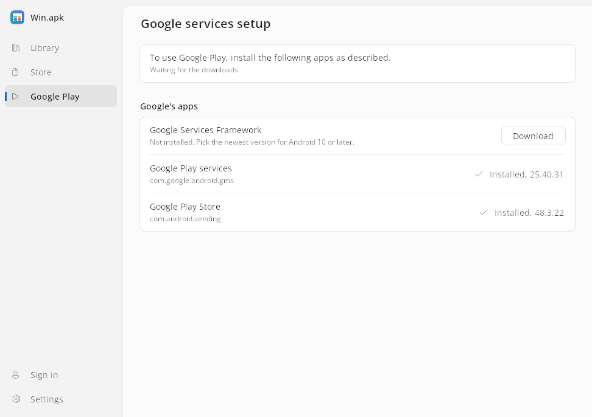

# Google account and Google services

**🇮🇱 [לדף הזה בעברית — לחצו כאן](he/google-services.md)**

Many Android apps use Google Play services: to sign in with Google, check
their Play licence, receive push messages or ask for the location. Win.apk
offers two levels of support.

| | Built in (default) | Google services (experimental) |
|---|---|---|
| What runs | Win.apk's own stand-ins, inside each app | Google's real Play services, Services Framework and Play Store, which you install |
| Sign in with Google | ✅ | ✅ |
| Play licence checks | ✅ | ✅ |
| Push messages (Firebase Cloud Messaging) | ✅ | ✅ from Google's Play services |
| Firebase Analytics, fused location | ✅ | ✅ |
| Apps that insist on Google's own Play services | ❌ | ⚠️ tried with a few apps |
| The Play Store | ❌ | ⚠️ signs in, installs and updates free apps |
| In-app purchases, Play Integrity, the Maps SDK's map | ❌ | ❌ |

Start with the built-in level. Turn Google services on only for an app that
needs it.

## Signing in

**Settings > Google account > Sign in** opens Google's own sign-in page in a
window of its own (Microsoft Edge WebView2, private profile). Win.apk never
sees your password; it keeps the token Google hands back, only on this PC, in
`%LOCALAPPDATA%\Win.apk\gms`.

- **One account for every app.** An app's **Sign in with Google** opens the
  same window when no account is signed in yet; with an account, the app shows
  its chooser.
- The round button at the end of the library's toolbar shows the signed-in
  account's picture and opens Settings.
- **Sign out** forgets the account and its tokens on this PC.
- Signing in works behind a filter or proxy whose certificate Windows trusts,
  such as NetFree.
- It needs the WebView2 Runtime (2022 or later). Without it the sign-in is
  cancelled and `logs\gms.log` says why.

## Google services (experimental)

**Settings > Google account > Use Google services (experimental)** (off by
default) runs Google's real Play services, Services Framework and Play Store
as apps, once you have installed them yourself. Win.apk never ships or
downloads Google's apps.

### Setting it up

1. Turn on **Use Google services**. The **Google services setup** page opens
   by itself (later: **Google Play** in the left pane, or the row under the
   switch).
2. For each of the three apps, Google Services Framework, Google Play services
   and Google Play Store, click **Download**. It opens the app's APKMirror page
   in your browser. Pick the variant the row names (x86_64 or nodpi, for
   Android 10 or later) and use APKMirror's own download button.
3. Keep the page open. Win.apk watches your Downloads folder (or take a file
   you drop on the page), checks that **Google signed it**, and installs it.
   A file someone else signed is refused with the reason.
4. When all three are ticked, **Google Play** in the left pane opens the Play
   Store.

The first time, Play services needs about a minute to check in with Google; a
Play Store opened before that may show "Server error" (press **Try again**).
From then on the Play Store keeps itself and Play services up to date.

### What was tried

With Google's own APKs: push-message tokens for Telegram, Moovit and the Play
Store; the Play Store signed in with the account; installing an app from it
(Google's Calculator: download, the install question, the app in the library
with the Play Store as its installer, and the app opens); the Play Store
updating its own helper apps. Most apps have not been tried yet: please
[report](troubleshooting.md#reporting-a-problem) what you find.

### How it works and what it means for privacy

- Each app runs in its own process. A small background process, the system
  broker (`winapk-runtime --system`), lets one app reach another's services,
  as Android's system server does. The first app that needs it starts it, and
  it exits a minute after the last app closes.
- Only copies whose signature verifies with Google's key (or a newer Google
  key that took over from it) are treated as Google's apps. An app that only
  uses their package names is an ordinary app.
- Google sees this PC as a device of its own: brand, maker and model
  "Win.apk", device "winapk", hardware "x86_64". Win.apk never claims to be a
  real phone. (Before v0.8.0 it called itself "Mac.apk", so Google meets it as
  a new device once.)
- Every app still runs with your Windows account's rights; there is no
  sandbox between apps on Windows.

Logs: `logs\google-setup.log` (the setup's checks), `logs\system.log` (the
broker), `logs\services\` (apps it started for other apps).

## What does not work, and will not be faked

In-app purchases report billing unavailable, there is no Play Integrity or
SafetyNet attestation, and the Google Maps SDK lays out a blank map. An app
that requires one of these will not fully work. Win.apk will not forge Google's
attestation or licence answers ([CONTRIBUTING.md](../CONTRIBUTING.md#out-of-scope)).
Where an app has an open-source build without Google's libraries (often on
F-Droid), use that.
